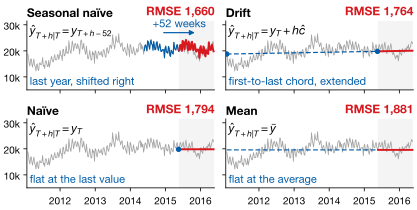
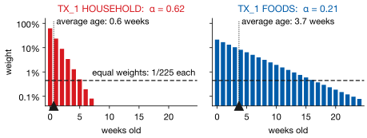
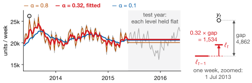
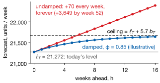
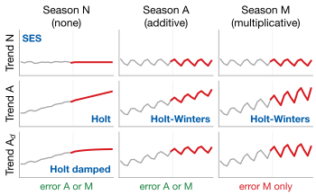
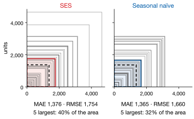

## Lecture Outline

1. Why Forecasting Matters
2. Exponential Smoothing
3. Forecast Evaluation
4. Course Roadmap

# Why Forecasting Matters

Every business decision made today depends on expectations about tomorrow.

---

## Forecasting Is Everywhere in Business

| Domain | The question someone is actually asking |
|--------|------------------------------------------|
| Operations & supply chain | How much inventory should Walmart order for Black Friday? How many nurses does a hospital need next Tuesday night? |
| Finance & risk | Will credit card defaults rise next quarter? What will the Fed Funds rate be in six months? |
| Marketing & strategy | How many units will this new product sell in year one? What is the lifetime value of this customer cohort? |
| Macro & public policy | Will GDP grow by 2% or 3% next year? What will unemployment be in Q4? |

Every one of these is a *decision* waiting on a number. **A decision is only as good as the forecast it rests on.**

---

## The Basic Setup

::: {.definitionbox}
::: {.definitionbox-title}
Time Series
:::
A [time series]{.hi} is an ordered sequence of observations $\{y_1, y_2, \ldots, y_T\}$ where $t$ indexes time.
:::

**Notation for the whole course:**

- $y_t$ — observed value at time $t$
- $h$ — [forecast horizon]{.hi}: harder as $h$ grows, as uncertainty compounds
- $\hat{y}_{t+h|t}$ — forecast of $y_{t+h}$ made using information at time $t$
- $e_t = y_t - \hat{y}_{t|t-1}$ — [forecast error]{.hi}

Under squared-error loss the best forecast is the **conditional expectation**, $\hat{y}_{t+h|t} = \mathbb{E}[y_{t+h} \mid \mathcal{F}_t]$, where $\mathcal{F}_t$ is everything known at time $t$.

---

## Components of a Time Series

Any series can be decomposed into four parts (additive form): $y_t = T_t + S_t + C_t + I_t$.

- [$T_t$ Trend]{.hi} — long-run direction
- [$S_t$ Seasonality]{.hi} — regular, calendar-driven pattern
- [$C_t$ Cycle]{.hi} — medium-run business-cycle swings
- [$I_t$ Irregular]{.hi} — random shocks

Which parts matter depends on the series: retail sales are trend + seasonality, quarterly GDP is trend + cycle, daily stock returns are mostly irregular.

::: {.warningbox}
**Ignoring seasonality causes large, systematic errors.** A non-seasonal model on monthly retail data will consistently under-forecast December and over-forecast January — every single year.
:::

---

## Always Beat a Benchmark First

Before presenting any model, check that it beats a **naive benchmark**: a model that cannot beat the baseline has zero value. Each forecast (red) is built from a line (blue):

{fig-align="center" height="400px"}

[CA_1 FOODS; RMSE over the 52 shaded test weeks. In the M4 Competition many machine learning models *failed* to beat simple exponential smoothing [@Makridakis2020].]{.neutral .smaller}

# Exponential Smoothing

Recent observations should carry more weight than old ones.

---

## The Problem with Equal Weights

Most classical methods weight every observation equally — but what if the world **changes**? After a store renovation, equal weights keep forecasting the old store for months.

**Exponential weighting:** an observation $k$ weeks old gets weight $\alpha(1-\alpha)^k$. High $\alpha$ = short memory; low $\alpha$ = long memory:

{fig-align="center" height="300px"}

[Fitted $\alpha$ on two aisles of one store. Log scale: each week back is the same step down, $\times(1-\alpha)$.]{.neutral .smaller}

---

## Simple Exponential Smoothing (SES)

::: {.definitionbox}
::: {.definitionbox-title}
SES Update Equation
:::
The **level** $\ell_t$ closes the fraction $\alpha$ of each week's gap ($0 < \alpha \leq 1$); the forecast is flat.

$$
\ell_t = \alpha\, y_t + (1-\alpha)\,\ell_{t-1}
       = \ell_{t-1} + \alpha\,(y_t - \ell_{t-1}),
\qquad \hat{y}_{T+h|T} = \ell_T
$$
:::

{fig-align="center" height="270px"}

[Large $\alpha$ chases every wiggle; small $\alpha$ is smooth but slow. SES **nests both benchmarks**: $\alpha = 1$ is naïve, $\alpha \to 0$ the historical mean.]{.smaller} [*No trend, no season.*]{.neutral .smaller}

---

## Holt's Method: Adding Trend

SES is *flat*. For a trending series, track the level $\ell_t$ and the slope $b_t$:

::: {.definitionbox}
::: {.definitionbox-title}
Holt's Linear Exponential Smoothing [@Holt2004]
:::
**Level:** $\ell_t = \alpha\, y_t + (1-\alpha)\,(\ell_{t-1} + b_{t-1})$

**Trend:** $b_t = \beta^*(\ell_t - \ell_{t-1}) + (1-\beta^*)\,b_{t-1}$

**Forecast:** $\hat{y}_{T+h|T} = \ell_T + h\,b_T$
:::

:::: {.columns}
::: {.column width="40%"}
**Straight lines get unrealistic far out.** For $h > 6$, the **damped trend** multiplies each week's rise by $\phi$ ($0 < \phi < 1$), so the forecast levels off under $\ell_T + b_T\,\phi/(1-\phi)$.
:::
::: {.column width="58%"}
{fig-align="center" height="300px"}
:::
::::

---

## Holt-Winters: Level, Trend, and Seasonality

::: {.definitionbox}
::: {.definitionbox-title}
Holt-Winters Additive Method [@Winters1960]
:::
$$
\begin{aligned}
\ell_t &= \alpha(y_t - s_{t-m}) + (1-\alpha)(\ell_{t-1}+b_{t-1}) \\
b_t &= \beta^*(\ell_t - \ell_{t-1}) + (1-\beta^*)\,b_{t-1} \\
s_t &= \gamma(y_t - \ell_{t-1} - b_{t-1}) + (1-\gamma)\,s_{t-m} \\
\hat{y}_{T+h|T} &= \ell_T + h\,b_T + s_{T+h-m} \qquad (m = \text{seasonal period})
\end{aligned}
$$
:::

:::: {.columns}
::: {.column width="48%"}
**Additive seasonality:**

- Swings constant in size: the same ± amount every December
:::
::: {.column width="48%"}
**Multiplicative seasonality:**

- Swings grow with the level: retail sales, tourism
:::
::::

US retail's December spike grows as overall sales grow: **multiplicative**.

[Needs at least $2m$ observations to initialize ($m=12$ for monthly data).]{.neutral .smaller}

---

## The ETS Framework: A Unified View

@Hyndman2021 unify every exponential smoothing method as a **state space model**: Error × Trend × Seasonal. Trend and season set the forecast's shape:

{fig-align="center" height="380px"}

[The error, A or M, changes the intervals, not the shape. Additive error with a multiplicative season is unstable, so 9 × 2 − 3 = 15 models. **Automatic selection:** fit all 15, keep the minimum AIC (`ETSModel` in statsmodels).]{.smaller} [Schematic shapes, not data.]{.neutral .smaller}

# Forecast Evaluation

Forecasting without evaluation is not science — it is storytelling.

---

## How Do We Measure Forecast Accuracy?

Draw each out-of-sample error $e_{T+h} = y_{T+h} - \hat{y}_{T+h|T}$ as a square. CA_1 FOODS, the 52 test weeks:

:::: {.columns}
::: {.column width="36%"}
$$\text{MAE} = \tfrac{1}{H}\sum_{h=1}^{H} |e_{T+h}|$$

$$\text{RMSE} = \sqrt{\tfrac{1}{H}\sum_{h=1}^{H} e_{T+h}^2}$$

[MAE is the average **side** (dashed). RMSE is the side of the average **square** (filled), so $\text{RMSE} \geq \text{MAE}$.]{.smaller}
:::
::: {.column width="62%"}
{fig-align="center" height="430px"}
:::
::::

[A tie on MAE, not on RMSE: five big misses carry 40% of SES's squared error. When big misses are costly — a stockout — prefer RMSE.]{.smaller}

---

## Comparing Across Series: MAPE and MASE

RMSE and MAE come in the units of $y_t$, so they compare models on the *same* series. To compare *across* series, scale the errors:

$$
\text{MAPE} = \frac{100\%}{H}\sum_{h=1}^{H}\left|\frac{e_{T+h}}{y_{T+h}}\right|
\qquad\qquad
\text{MASE} = \frac{\text{MAE}}{\displaystyle\frac{1}{T-m}\sum_{t=m+1}^{T} |y_t - y_{t-m}|}
$$

The MASE denominator is seasonal naïve's average miss **on the training data**. $\text{MASE} < 1$: smaller errors than that; $\text{MASE} > 1$: [worse]{.negative}. It is the standard in the M-Competitions [@Makridakis2020].

[MAPE breaks down when $y_t$ is near zero; MASE does not.]{.neutral .smaller}

---

## The Golden Rule: Always Evaluate Out-of-Sample

**Never evaluate a forecast model on the data used to fit it.** In-sample fit measures how well the model memorized the past, not how well it predicts the future.

```{mermaid}
flowchart LR
    A["Training set<br/>t = 1 … T"] -->|forecast origin| B["Test set<br/>t = T+1 … T+H"]
```

::: {.warningbox}
**Never randomly shuffle time series observations.** Use `TimeSeriesSplit` in scikit-learn, never `KFold`. Shuffling lets future data train the model — data leakage that makes results look excellent and forecast badly.
:::

# Course Roadmap

What we will cover, and how it fits together.

---

## ECON 8310: Four-Part Structure

| Part | Lectures |
|------|----------|
| I. Time series | 1. Intro, ETS & evaluation *(today)* &emsp; 2. ARIMA & VAR &emsp; 3. Generalized additive models |
| II. Tree-based | 4. Decision trees &emsp; 5. Tree ensembles: random forests & boosted trees &emsp; 6. Regularization & model selection |
| III. Deep learning | 7. Neural networks (PyTorch) &emsp; 8. CNN architectures &emsp; 9. RNNs, LSTMs & Transformers |
| IV. Bayesian | 10. Foundations &emsp; 11. Time series & hierarchical models &emsp; 12. Bayesian linear regression |

[Python throughout: statsmodels, scikit-learn, xgboost, PyTorch, prophet, pyGAM, pymc.]{.neutral .smaller}

---

## Tools and What You Will Be Able to Do

**The Python stack:** `statsmodels` (ETS, ARIMA, VAR) · `scikit-learn` (models, pipelines, cross-validation) · `xgboost` (gradient boosting) · `torch` (neural networks) · `prophet` and `pygam` (GAMs) · `pymc` (Bayesian models).

**By the end of the semester you will be able to:**

- Choose the right method for a given business problem
- Implement and tune it in Python
- Evaluate it rigorously out-of-sample
- Interpret the result for a non-technical stakeholder
- Use AI tools effectively to accelerate the analysis
- Avoid the most common forecasting mistakes

---

## Lecture 1: Key Takeaways

::: {.keybox}
1. Under squared loss the best forecast is the **conditional expectation**.

2. **Always beat a benchmark first:** naïve, seasonal naïve, mean, drift.

3. Exponential smoothing weights the past **geometrically**; $\alpha$ sets how fast it forgets.

4. SES → Holt (+ trend) → Holt-Winters (+ season): all **ETS** models, chosen by AIC.

5. **Evaluate out-of-sample, never shuffled.** RMSE punishes big misses; MASE compares across series.
:::

*Next: ARIMA & VAR — a regression-based approach to time series with richer autocorrelation structure.*

---

## References

::: {#refs}
:::
