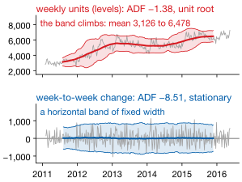
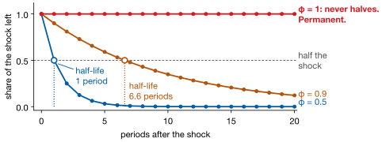
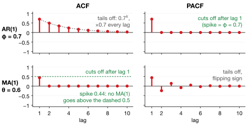
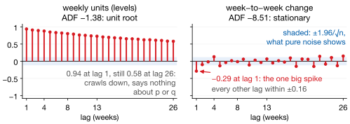
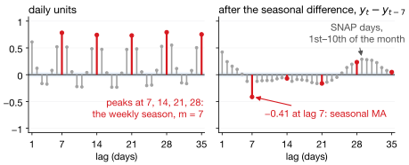
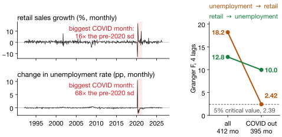

## Lecture Outline

1. Stationarity and Differencing
2. ARIMA Models
3. VAR Models
4. Key Takeaways and Roadmap

# Stationarity and Differencing

Before fitting any model, the series must have a stable mean and variance.

---

## What Is Stationarity?

:::: {.columns}
::: {.column width="47%"}
::: {.definitionbox}
::: {.definitionbox-title}
Weak (Covariance) Stationarity
:::
$\{y_t\}$ is **weakly stationary** if:

1. constant mean: $\mathbb{E}[y_t] = \mu$
2. constant variance: $\mathrm{Var}(y_t) = \sigma^2 < \infty$
3. $\mathrm{Cov}(y_t, y_{t-k}) = \gamma_k$ depends only on lag $k$, not on $t$
:::

[Conditions 1–2, pictured: the series stays inside a **horizontal band of fixed width**. TX_1 HOUSEHOLD fails; its weekly change passes.]{.smaller}
:::
::: {.column width="51%"}
{fig-align="center" height="400px"}
:::
::::

[A drifting mean leaves no single value to forecast; a growing variance widens intervals without bound. Differencing removes a stochastic trend; a log stabilizes the variance.]{.smaller}

---

## Unit Roots and Differencing

**AR(1):** $y_t = \phi_1\,y_{t-1} + \varepsilon_t$. Give it one unit shock and watch what is left of it:

{fig-align="center" height="340px"}

Below one, each period keeps the same share $\phi_1$, so the shock halves every $\ln 0.5 / \ln \phi_1$ periods. At $\phi_1 = 1$, a **unit root**, it never fades: a random walk. **Differencing**, $\Delta y_t = y_t - y_{t-1}$, removes it. $d$ counts first differences; $D$ counts seasonal ones, $\Delta_{12}y_t = y_t - y_{t-12}$.

---

## Testing for a Unit Root

Rule of thumb: a visible trend or growing variance means the series is likely non-stationary. Then test formally.

**ADF** ($H_0$: unit root) and **KPSS** ($H_0$: stationary) test *opposite* nulls, so run both, and be suspicious when they disagree.

::: {.warningbox}
**Do not over-difference.** Differencing an already-stationary series induces negative autocorrelation that you then have to model away. Difference, re-test, and stop at $d = 1$ once the result is stationary.
:::

[Lab 1's TX_1 HOUSEHOLD: ADF −1.38 on the levels (a unit root), −8.51 after one difference (stationary). So $d = 1$.]{.neutral .smaller}

---

## Why the Rule Exists: Spurious Regression

Differencing is not bookkeeping. Skip it and the statistics actively lie to you.

<svg viewBox="0 0 380 160" xmlns="http://www.w3.org/2000/svg" style="width:100%;max-width:680px;height:auto" role="img" aria-label="Two independent random walks that appear to trend together">
<line x1="10" y1="145" x2="360" y2="145" stroke="currentColor" stroke-opacity=".55"/>
<line x1="10" y1="12" x2="10" y2="145" stroke="currentColor" stroke-opacity=".55"/>
<polyline points="10.0,136.9 18.4,129.3 26.8,131.5 35.2,125.1 43.6,112.6 52.0,105.6 60.4,86.3 68.8,93.1 77.2,89.7 85.6,94.5 94.0,100.2 102.4,99.5 110.8,94.5 119.2,87.4 127.6,79.3 136.0,52.9 144.4,41.0 152.8,55.3 161.2,50.5 169.6,54.5 178.0,57.3 186.4,40.7 194.8,40.5 203.2,58.6 211.6,52.6 220.0,53.0 228.4,62.9 236.8,70.0 245.2,74.0 253.6,71.6 262.0,73.5 270.4,70.1 278.8,47.9 287.2,53.7 295.6,59.6 304.0,59.6 312.4,45.3 320.8,50.2 329.2,32.2 337.6,43.5" fill="none" stroke="#D71920" stroke-width="2"/>
<polyline points="10.0,132.6 18.4,149.5 26.8,155.7 35.2,152.8 43.6,135.1 52.0,132.9 60.4,148.5 68.8,143.1 77.2,153.7 85.6,138.6 94.0,139.2 102.4,118.2 110.8,117.5 119.2,126.3 127.6,139.8 136.0,141.6 144.4,134.8 152.8,120.0 161.2,115.1 169.6,120.9 178.0,113.4 186.4,126.6 194.8,119.2 203.2,125.1 211.6,107.1 220.0,94.4 228.4,88.4 236.8,97.2 245.2,89.3 253.6,83.3 262.0,87.0 270.4,91.5 278.8,75.9 287.2,78.1 295.6,71.3 304.0,54.4 312.4,68.1 320.8,47.0 329.2,34.1 337.6,38.9" fill="none" stroke="currentColor" stroke-width="2"/>
<text x="352" y="38" font-size="11" fill="#D71920">x</text>
<text x="352" y="72" font-size="11" fill="currentColor">y</text>
</svg>

Two independent random walks — **no shared cause, no relationship at all**. Their *changes* correlate at −0.13, which is the truth. But their *levels* correlate at +0.62, and that is what OLS sees.

::: {.warningbox}
@GrangerNewbold1974 showed this rejects "no relationship" about **three-quarters** of the time at the 5% level. The regression is not finding a relationship — it is finding that both series wander. **Difference first.**
:::

---

## ACF and PACF: Model Identification

The **autocorrelation function**, $\rho_k = \mathrm{Corr}(y_t, y_{t-k})$, measures how $y_t$ relates to its own past. The **partial** autocorrelation controls for the lags in between, which separates a direct effect from one inherited through them.

Read together, they identify the model:

| Model | ACF | PACF |
|-------|-----|------|
| AR($p$) | Tails off geometrically | [Cuts off]{.positive} after lag $p$ |
| MA($q$) | [Cuts off]{.positive} after lag $q$ | Tails off geometrically |
| ARMA | Tails off | Tails off |
| RW / I(1) | Decays slowly | Big spike at lag 1 |

---

## What Those Patterns Actually Look Like

{fig-align="center" height="450px"}

Exact values, not a sample. Read the pair: the [sharp cut-off]{.positive} gives the order, the *slow decay* says which side it is on. The AR(1) ACF is a staircase: each lag keeps $\phi$ of the one before.

---

## Difference First, Then Read the ACF

Lab 1's TX_1 HOUSEHOLD series, before and after one difference:

{fig-align="center" height="340px"}

The levels' ACF crawls down whatever the process is: it only says you have not differenced yet. The change has one negative spike at lag 1, the MA(1) signature. So ARIMA(0,1,1), which is simple exponential smoothing: Lab 1's $\alpha = 0.62$ implies $\rho_1 = -0.33$; the data show $-0.29$.

# ARIMA Models

Combine differencing with AR and MA components into one unified model.

---

## ARIMA($p$,$d$,$q$)

::: {.definitionbox}
::: {.definitionbox-title}
ARIMA($p$,$d$,$q$) Model
:::
Difference the series $d$ times, $y'_t = \Delta^d y_t$, then fit an ARMA($p$,$q$) to $y'_t$:

$$y'_t = c + \sum_{i=1}^{p}\phi_i\, y'_{t-i} + \varepsilon_t + \sum_{j=1}^{q}\theta_j\,\varepsilon_{t-j}$$
:::

Familiar models are corners of this space: **ARIMA(0,1,0)** is a random walk, **ARIMA(1,0,0)** an AR(1), and **ARIMA(0,1,1)** simple exponential smoothing.

**A forecast by hand.** ARIMA(1,1,0) with $\hat{\phi}_1 = 0.5$, $y_{100} = 120$ and $y_{99} = 118$. The last change was 2, so the next is half of it: $\hat{y}_{101|100} = 120 + 0.5 \times 2 = \mathbf{121}$.

[**Python:** `pmdarima.auto_arima()` searches orders; `statsmodels.SARIMAX` fits the order you choose.]{.neutral .smaller}

---

## SARIMA: Adding Seasonal Terms

Seasonal data also correlate at lags $m, 2m, 3m, \ldots$, and SARIMA adds AR and MA terms there: **two ARIMA models at different time scales**, $(p,d,q)$ for the short run and $(P,D,Q)[m]$ for the season.

{fig-align="center" height="330px"}

[CA_1 FOODS is daily, so $m = 7$ here (monthly data use $m = 12$). One seasonal difference, $D = 1$, removes the peaks; the spike left at lag 7 points to one seasonal MA term, $Q = 1$.]{.smaller}

---

## SARIMA in Practice: A Four-Step Workflow

**Practical workflow:**

1. ADF / KPSS → choose $d$
2. Seasonal unit root test → choose $D$
3. ACF / PACF on the differenced series → guide $p, q, P, Q$
4. Minimize AIC, then check the residual ACF with a Ljung-Box test

**Ljung-Box** ($H_0$: the residuals are white noise) is the one people skip. Here a *large* $p$-value is the good outcome: nothing left to model.

[Monthly retail: start from SARIMA(1,1,1)(0,1,1)[12] and make anything fancier beat it.]{.neutral .smaller}

# VAR Models

When two series influence each other, model them together symmetrically.

---

## Why Use Multiple Series?

Every model so far — ETS, ARIMA — uses only $y_t$'s own history. But business variables are linked: consumer sentiment today moves retail spending next month, and advertising moves sales over the following weeks.

::: {.keybox}
If $x_t$ carries information about $y_{t+h}$ that is not already in $y_t$'s own history, including $x_t$ reduces forecast error.
:::

**Granger causality** [@Granger1969] is the formal test of exactly that claim. It comes right after the VAR.

---

## VAR or ARIMAX: Which Way Does Influence Run?

The modeling choice turns on whether the influence runs one way or both:

:::: {.columns}
::: {.column width="48%"}
**VAR — symmetric**

- Every variable predicts every other
- Use when influence runs both ways
- No variable is privileged
- Example: retail sales and unemployment (the lab)
:::
::: {.column width="48%"}
**ARIMAX — one direction**

- $x_t$ drives $y_t$, not the reverse
- Use when the causal story is clear
- Needs a forecast of $x_t$ itself
- Example: advertising → sales
:::
::::

---

## The VAR($p$) Model

For two stationary series and $p = 1$, each equation regresses on the lags of *both*:

$$\begin{cases} y_{1t} = c_1 + a_{11}\,y_{1,t-1} + a_{12}\,y_{2,t-1} + \varepsilon_{1t}\\ y_{2t} = c_2 + a_{21}\,y_{1,t-1} + a_{22}\,y_{2,t-1} + \varepsilon_{2t} \end{cases}$$

The cross terms carry the value: $a_{12}$ is how much $y_{2,t-1}$ predicts $y_{1t}$, what a univariate AR throws away. If $a_{12} = a_{21} = 0$, it is two separate ARs.

::: {.warningbox}
**Parameter explosion.** $k$ variables and $p$ lags make $k^2 p$ coefficients: at $k=5$, $p=4$, **100**: 21 per equation, from about 116 months in ten years. Keep $k \leq 4$, or use a LASSO-VAR.
:::

[**Python:** `statsmodels.tsa.api.VAR`; `var.fit(maxlags=p, ic='bic')` picks $p$ by BIC.]{.neutral .smaller}

---

## Granger Causality Test

::: {.definitionbox}
::: {.definitionbox-title}
Granger Causality
:::
$x_t$ **Granger-causes** $y_t$ if past values of $x_t$ help predict $y_t$ *beyond what $y_t$'s own past already explains*.
:::

**The test:** fit the $y$-equation with and without the $x$-lags; an $F$-test of $H_0$: all $x$-lag coefficients are zero.

**Not structural causality.** It tests predictive content: umbrella sales Granger-cause rain, because shoppers read the forecast. Say "predictive of," never "causes."

---

## Granger on Real Data: The COVID Window

**Does unemployment Granger-cause retail sales?** Lab 2's monthly FRED data:

{fig-align="center" height="390px"}

[Both directions are significant in both samples; one shock decides which looks stronger. With COVID: unemployment → retail. Without its 17 months: retail → unemployment.]{.smaller}

---

## ARIMAX: Exogenous Variables with ARIMA Errors

When one variable clearly *drives* another, use ARIMAX.

::: {.definitionbox}
::: {.definitionbox-title}
ARIMAX Model
:::
$$y_t = \mathbf{x}_t'\boldsymbol{\beta} + \eta_t, \qquad \eta_t \sim \mathrm{ARIMA}(p,d,q)$$

$\mathbf{x}_t$ are exogenous regressors; $\eta_t$ absorbs the autocorrelation left in the residuals.
:::

**Use it when** the direction is clear (advertising → sales), you have $x_t$ or can forecast it, and adding it cuts cross-validated error. Check that last one.

**The catch:** forecasting $y_{t+h}$ needs $x_{t+h}$, a forecast of your own predictor. Without one, use a VAR, which forecasts every series it contains.

[**Python:** `SARIMAX(y, exog=X, order=(p,d,q)).fit()`]{.neutral .smaller}

# Key Takeaways and Roadmap

Stationarity, ARIMA, VAR, and ARIMAX form the classical time-series toolkit.

---

## Lecture 2: Key Takeaways

::: {.keybox}
1. **Stationarity first:** test with ADF and KPSS (opposite nulls); difference away a unit root.

2. **ACF** gives the MA order, **PACF** the AR order — read after differencing.

3. **ARIMA($p$,$d$,$q$)** is an ARMA on the differenced series; SARIMA adds seasonal terms; `auto_arima` searches.

4. **VAR** treats series symmetrically; keep $k \leq 4$. **Granger** tests predictive content, not causation.

5. **ARIMAX** adds exogenous predictors, if you can forecast them.
:::

*Next: Generalized Additive Models (GAMs) — flexible, interpretable nonlinear forecasting with Prophet and pyGAM.*

---

## References

::: {#refs}
:::
