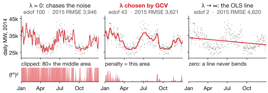
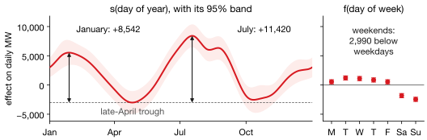

## Lecture Outline

1. Motivation: Beyond Linear, Without Black Boxes
2. GAM Structure and Smoothing
3. Prophet for Time Series GAMs
4. pyGAM for General Additive Modeling
5. Key Takeaways

# Motivation: Beyond Linear, Without Black Boxes

We want flexibility to capture nonlinear relationships while still being able to *explain* what the model is doing.

---

## The Flexibility--Interpretability Tradeoff

:::: {.columns}
::: {.column width="48%"}
**Linear models (ARIMA, regression):**

- [✓]{.positive} Each coefficient has a clear meaning
- [✓]{.positive} Stable, well understood
- [✗]{.negative} One constant slope everywhere
- [✗]{.negative} Miss curves and thresholds
:::
::: {.column width="48%"}
**Fully nonlinear models (trees, neural nets):**

- [✓]{.positive} Capture almost any pattern
- [✓]{.positive} Accurate on complex data
- [✗]{.negative} Hard to explain one prediction
- [✗]{.negative} Interactions entangle variables
:::
::::

**GAMs sit between:** a flexible curve per variable, **added** together, so each effect still plots on its own.

---

## Why Additivity Matters for Interpretation

In a non-additive model the effect of one variable depends on the value of another, so you cannot describe them separately.

**Concretely.** Suppose the truth is $y = x_1^2 x_2^2 + \varepsilon$. Then $\partial y / \partial x_1 = 2x_1 x_2^{2}$ — it depends on *both* variables. There is no answer to "what does $x_1$ do to $y$?" that does not begin with "it depends on $x_2$."

::: {.examplebox}
::: {.examplebox-title}
GAM Marginal Effects Are Simple
:::
In a GAM, $y = f_1(x_1) + f_2(x_2) + \varepsilon$, so the marginal effect of $x_1$ is just $f_1'(x_1)$ — a function of $x_1$ alone, whatever $x_2$ happens to be.

**That is why you can plot each variable's effect separately and hand the plot to a stakeholder.**
:::

# GAM Structure and Smoothing

Additive nonlinear functions, penalized for wiggliness.

---

## What Is a GAM?

::: {.definitionbox}
::: {.definitionbox-title}
Generalized Additive Model
:::
$$y = \alpha + f_1(x_1) + f_2(x_2) + \cdots + f_k(x_k) + \varepsilon$$

where each $f_j(\cdot)$ is a **smooth, nonlinear function** estimated from the data [@Wood2017].
:::

Each $f_j$ is free to be linear, curved, U-shaped, or threshold-like — the data decides. Because the terms are *added*, each one can be plotted on its own. A smoothness penalty, two slides on, keeps them from chasing noise.

**A retail example.** Weekly sales as $f_1(\text{time})$ for the trend, plus $f_2(\text{week of year})$ for seasonality, plus $f_3(\text{unemployment})$ for economic sensitivity: three curves, each read on its own.

---

## What the "Generalized" Actually Means

So far every $y$ we have modelled has been continuous and roughly symmetric — sales in dollars, demand in units. For that case an *additive* model is enough. The **G** in GAM is what happens when $y$ is not that kind of variable.

::: {.definitionbox}
::: {.definitionbox-title}
Generalized Additive Model, in full
:::
$$g\big(\mathbb{E}[y]\big) = \alpha + f_1(x_1) + \cdots + f_k(x_k)$$

The additive predictor models a *transformation* of the mean. That transformation $g(\cdot)$ is the **link function**.
:::

| If $y$ is… | Distribution | Link $g(\cdot)$ |
|---|---|---|
| Continuous, symmetric (sales) | Gaussian | Identity — $g(\mu)=\mu$ |
| A count (units, visits, claims) | Poisson | Log — keeps the forecast positive |
| Binary (churn, stockout, yes/no) | Binomial | Logit — keeps it inside $[0,1]$ |

[In `pyGAM` this is the difference between `LinearGAM`, `PoissonGAM`, and `LogisticGAM` — same additive structure, different link. Everything else in this lecture is unchanged.]{.neutral .smaller}

---

## Controlling Smoothness: The Penalty Term

A GAM minimizes a **penalized** sum of squared errors:

$$\text{PSSE} = \underbrace{\sum_{i=1}^{n}(y_i - \hat{y}_i)^2}_{\text{fit}} + \underbrace{\lambda \int (f''(x))^2\,dx}_{\text{smoothness penalty}}$$

{fig-align="center" height="285px"}

[$f''$ measures bending, so the penalty is the shaded area: zero only for a straight line. Same data, same 100 splines (cubic pieces joined at knots); only $\lambda$ changes, and GCV chooses it, not your eye.]{.smaller}

# Prophet for Time Series GAMs

Facebook's Prophet decomposes a time series into trend, seasonality, and holiday effects using a GAM.

---

## Prophet: Forecasting at Scale

@TaylorLetham2018 built Prophet for large-scale forecasting at Meta. It is a GAM in time-series clothing — the series is decomposed additively:

$$y(t) = \underbrace{g(t)}_{\text{trend}} + \underbrace{s(t)}_{\text{seasonality}} + \underbrace{h(t)}_{\text{holidays}} + \varepsilon_t$$

**Trend $g(t)$**: piecewise linear or logistic, with *changepoints* where the slope may shift. **Seasonality $s(t)$**: a Fourier series, so weekly and yearly cycles fit at once. **Holidays $h(t)$**: irregular events you supply — Black Friday, a launch, a lockdown.

Built for analysts, not statisticians: one fit-and-forecast call, robust to gaps and outliers, and every component plots on its own.

---

## Prophet: Code and Workflow

::: {.examplebox}
::: {.examplebox-title}
Prophet on Retail Sales
:::
```python
from prophet import Prophet

df = pd.DataFrame({'ds': dates, 'y': sales})
m = Prophet(changepoint_prior_scale=0.05, yearly_seasonality=True).fit(df)

future = m.make_future_dataframe(periods=12, freq='M')
forecast = m.predict(future)
m.plot_components(forecast)
```
:::

`plot_components` is the call that matters here: it draws the trend with its changepoints, the yearly wave, and the day-of-week pattern as separate panels — the additive structure made visible.

**Reach for Prophet** on seasonal series with known holiday effects, especially when someone will ask you to explain the forecast. **Reach for pyGAM** when you have many correlated external predictors instead.

# pyGAM for General Additive Modeling

When you have multiple predictors and want flexible nonlinear effects for each.

---

## pyGAM: Flexible Additive Modeling

`pyGAM` fits a GAM with a smooth function you specify per predictor:

::: {.examplebox}
::: {.examplebox-title}
pyGAM Example
:::
```python
from pygam import LinearGAM, s, f, l

gam = LinearGAM(s(0) + s(1) + s(2) + f(3))
gam = gam.gridsearch(X, y)

pdep, confi = gam.partial_dependence(term=0, width=0.95)
y_hat = gam.predict(X_new)
```
:::

The three term types are the whole vocabulary: `s(j)` is a smooth spline of feature $j$ — the flexible nonlinear effect; `l(j)` forces a straight line, which is worth using when theory says the effect should be linear; and `f(j)` handles a binary or categorical feature.

`gridsearch` then tunes $\lambda$ by cross-validation — though you should still look at the resulting curves and ask whether they are plausible.

---

## Interpreting GAM Results: Partial Dependence Plots

Each panel is one $\hat{f}_j(x_j)$ with its confidence band, from Lab 3's electricity model:

{fig-align="center" height="280px"}

[Read the band too. Every day of the year is equally covered, so it barely changes width; where data thin out it fans, just where readers want to extrapolate.]{.smaller}

::: {.keybox}
A sentence someone can act on: *"plan for mid-July demand about 11,400 MW above the late-April trough, a winter peak about 8,500 above it, and weekends about 3,000 below weekdays."* No straight line in day of year has two peaks.
:::

# Key Takeaways and Roadmap

GAMs: flexible, interpretable, and underutilized in business forecasting.

---

## GAMs vs. Other Methods: When to Choose Each

| Method | Nonlinear | Interactions | Interpretable | Use case |
|--------|-----------|--------------|---------------|----------|
| ARIMA / ETS | No | No | High | Univariate time series |
| Linear regression | No | Manual | High | Few predictors |
| **GAM** | Yes | No | High | Few predictors, explain effects |
| Random Forest | Yes | Yes | Medium | Many predictors, tabular |
| XGBoost | Yes | Yes | Low | Many predictors, accuracy first |

The column that decides it is usually **Interactions**. A GAM is additive by construction, so if the effect of price depends on whether it is a holiday week, a GAM cannot represent that and a tree can.

**Choose a GAM when** you must explain each predictor's effect, the effects are curved, or a series has complex trend and seasonality (Prophet), and interpretability matters more than the last few points of accuracy. Whether a flexible model buys those points is an empirical question; Lectures 4–6 test it.

---

## Lecture 3: Key Takeaways

::: {.keybox}
1. **GAMs**, $y = \alpha + f_1(x_1) + \cdots + f_k(x_k) + \varepsilon$: nonlinear, yet additive, so each effect plots on its own.

2. The **smoothness penalty** prices bending; $\lambda$, chosen by GCV or cross-validation, trades fit against smoothness.

3. **Prophet** is a GAM for time series: trend + seasonality + holidays.

4. **pyGAM**: `s()` smooth, `l()` linear, `f()` categorical; `gridsearch` tunes $\lambda$.

5. **Partial dependence plots** turn the model into sentences a stakeholder can act on.
:::

*Next: Decision Trees — moving to tree-based methods that capture interactions automatically.*

---

## References

::: {#refs}
:::
