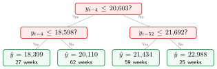
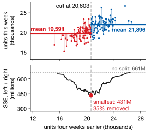
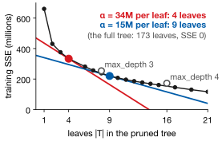

## Lecture Outline

1. Why Go Beyond Linear Models?
2. How Decision Trees Work
3. Implementing Decision Trees in Python
4. Limitations and Preview: Ensembles

# Why Go Beyond Linear Models?

Real-world relationships are often nonlinear, involve interactions, and shift with context.

---

## The Limits of Linear Models

**Three things a constant slope cannot represent:**

- **Interactions** — the holiday-season advertising effect is not a constant slope
- **Threshold effects** — spending may be flat until unemployment drops below 5%, then jump
- **Asymmetry** — extreme values distort coefficients equally in both directions

::: {.examplebox}
::: {.examplebox-title}
Retail Sales Example
:::
Monthly sales depend on last year's same-month sales (trend), whether it is December (seasonality), and the unemployment rate (conditions). The December effect is *larger* in a strong economy — an interaction a linear model misses.
:::

**Decision trees capture nonlinearity and interactions automatically**, without your having to specify them in advance.

---

## The Bias--Variance Tradeoff

::: {.definitionbox}
::: {.definitionbox-title}
Bias--Variance Decomposition
:::
$$\text{Expected MSE} = \underbrace{\text{Bias}^2}_{\text{systematic error}} + \underbrace{\text{Variance}}_{\text{sensitivity to data}} + \underbrace{\sigma^2}_{\text{irreducible noise}}$$
:::

:::: {.columns}
::: {.column width="48%"}
**High bias (underfitting):**

- Model is too simple
- Misses real patterns in the data
- Bad on both training AND test sets
- Example: linear model on a curved relationship
:::
::: {.column width="48%"}
**High variance (overfitting):**

- Model is too complex
- Memorizes training data noise
- Great on training, bad on test set
- Example: a very deep decision tree
:::
::::

**Goal:** find the complexity that balances the two — which you can only see *out-of-sample*.

# How Decision Trees Work

Partition the feature space into rectangles; predict the mean in each region.

---

## What Is a Decision Tree?

A flowchart of yes/no questions about the features, ending in a prediction. Here is the real depth-2 tree for weekly CA_1 FOODS units:

{fig-align="center" height="245px"}

**Non-parametric** · **nonlinear** (captures thresholds) · **interpretable** · **scale-invariant**. A single *deep* tree **overfits severely**; ensembles, the next lecture, are the fix.

[$y_{t-4}$: units four weeks earlier; $y_{t-52}$: the same week last year. Fitted on the 173 weeks before the test year.]{.neutral .smaller}

---

## The CART Algorithm (Regression)

:::: {.columns}
::: {.column width="42%"}
At each node, CART [@Breiman1984] tries every feature $j$ and threshold $t$, and keeps the split with the least squared error:

$$\textstyle\sum_{x_{ij} \leq t} (y_i - \bar{y}_{L})^2 + \sum_{x_{ij} > t} (y_i - \bar{y}_{R})^2$$

Each leaf predicts its mean; then repeat inside each group.

**Geometrically:** slide the cut and total the squared vertical sticks. Our best first cut, $y_{t-4} \leq 20{,}603$, removes 35% of the squared error.

[Classification uses Gini impurity or entropy instead.]{.neutral .smaller}
:::
::: {.column width="56%"}
{fig-align="center" width="90%"}
:::
::::

---

## Greedy Is Not Optimal --- and That Matters

CART is **exhaustive** at each node: it tries every feature and every threshold. But it is **greedy** across nodes: it never looks ahead. An illustration:

| Split at the root | Variance removed now | ...plus what it enables |
|-------------------|:--------------------:|:-----------------------:|
| On price | **40%** | $+$ 12%  (total 52%) |
| On promotion | 38% | $+$ 50%  **(total 88%)** |

CART takes the 40%. It cannot see the 50% coming: it scores one split at a time.

So a fitted tree is a sequence of locally best choices, **not the optimal tree** (finding that is intractable). It can **miss real structure**, and a small change in the data can send the greedy sequence down a different path: the instability we turn to next.

---

## Depth Controls the Bias--Variance Tradeoff

A **depth-1 stump** asks one question: high bias, low variance. A **full tree** with one observation per leaf memorizes the sample: zero bias, extreme variance.

| Depth | Bias | Variance | Behavior |
|-------|------|----------|----------|
| 1 (stump) | High | Low | One question; underfits |
| 5–10 | Balanced | Balanced | Usually the useful range |
| Full tree | Zero | Extreme | Memorizes the training sample |

**Why trees are unstable:** one changed observation can flip the split at the root, and every prediction below it changes with it.

Tune `max_depth` and `min_samples_leaf` by `TimeSeriesSplit` cross-validation.

---

## Two Ways to Stop a Tree Overfitting

`max_depth` caps the tree in advance. Two other controls do the job better.

| Parameter | What it does |
|-----------|--------------|
| `min_samples_leaf` | **Stop early.** At the default of 1, a leaf may hold a single observation and "predict" that one value. Set it to 5--10 and every prediction is an average over a real group. |
| `ccp_alpha` | **Prune after.** Grow the tree out fully, then charge a penalty $\alpha$ per leaf and cut back the branches that do not pay for themselves. |

Choose either one by `TimeSeriesSplit` cross-validation, never by the test year.

---

## Cost-Complexity Pruning: A Line Touching the Curve

Pruning minimizes $\sum_{\text{leaves}} \text{SSE} + \alpha\,|T|$: the fit, plus a price $\alpha$ for each of the $|T|$ leaves. Each black dot is the best pruned tree for some range of $\alpha$.

{fig-align="center" height="300px"}

[Push a line of slope $-\alpha$ up from below: the first dot it touches is the tree $\alpha$ picks. A bigger $\alpha$ tilts it and picks a smaller tree. The 4-leaf tree is the flowchart from earlier.]{.smaller}

[The same idea as Lecture 3's smoothing penalty and Lecture 6's Ridge and LASSO; $\alpha$ is chosen by cross-validation. scikit-learn's `ccp_alpha` is $\alpha/n$.]{.neutral .smaller}

# Implementing Decision Trees in Python

One class, a few hyperparameters, interpretable results.

---

## Decision Tree Regression in Python

::: {.examplebox}
::: {.examplebox-title}
sklearn Code Template
:::
```python
from sklearn.tree import DecisionTreeRegressor
from sklearn.model_selection import TimeSeriesSplit

X, y = weekly[FEATURES], weekly['units']   # lags, SNAP, events, price

tree = DecisionTreeRegressor(max_depth=5, min_samples_leaf=10, random_state=42)
tree.fit(X_train, y_train)
y_hat = tree.predict(X_test)
```
:::

| Parameter | Effect |
|-----------|--------|
| `max_depth` | Cap tree depth |
| `min_samples_leaf` | Minimum observations per leaf |
| `max_features` | Feature subsampling |
| `ccp_alpha` | Cost-complexity pruning |

Cross-validate with `TimeSeriesSplit`, never `KFold` — **random folds leak the future into the training set**.

---

## Feature Importance

::: {.definitionbox}
::: {.definitionbox-title}
Impurity-Based Feature Importance
:::
For each feature $j$, sum the total reduction in variance across all splits where $j$ was used, weighted by the fraction of observations in each node. Normalize so the importances sum to 1.
:::

| Feature (CA_1 FOODS, weekly) | Importance |
|------------------------------|-----------|
| `units_lag4` | 0.62 |
| `units_lag52` | 0.15 |
| `units_lag1` | 0.13 |
| `snap_days` | 0.05 |
| `avg_price` | 0.04 |

From the previous slide's depth-5 tree. Read it as a list of what the tree leaned on: a fast way to screen predictors.

[But impurity importance is biased toward high-cardinality features. Permutation importance and SHAP give more reliable attributions; we return to this in Lecture 5.]{.neutral .smaller}

---

## Interpreting and Communicating Tree Predictions

A tree's main advantage is that you can explain *why* a specific prediction was made.

::: {.examplebox}
::: {.examplebox-title}
Explaining a Prediction to a Manager
:::
"Our model forecasts 22,988 units for this week because:

1. Four weeks ago the store sold more than 20,603 units (recent demand is high)
2. The same week last year sold more than 21,692 (the season is strong)
3. The 25 training weeks where both held averaged 22,988 units."
:::

Produce the path with `sklearn.tree.plot_tree(tree)` or `export_text(tree, feature_names=[...])`.

[This is where business buy-in comes from — a manager can check that the tree is splitting on variables they consider sensible.]{.neutral .smaller}

# Limitations and Preview: Ensembles

A single tree is a weak learner. Combine hundreds to build a strong one.

---

## When a Single Tree Falls Short

:::: {.columns}
::: {.column width="48%"}
**Strengths:**

- Interpretable — can show the path
- No feature scaling needed
- Captures nonlinear relationships
- Handles missing values well
- Fast to train
:::
::: {.column width="48%"}
**Weaknesses:**

- High variance — small data changes give a very different tree
- Flat predictions within each leaf
- Cannot extrapolate beyond the training range
- Sensitive to outliers in a leaf
:::
::::

**The ensemble solution:** average many trees fitted to bootstrap samples. Variance falls sharply and feature importance survives, typically for 20–40% lower RMSE than one tree.

---

## Lecture 4: Key Takeaways

::: {.keybox}
1. Trees capture **interactions** and **thresholds** without being told.
2. Depth sets the **bias--variance** trade: too shallow underfits, too deep overfits.
3. **CART** takes the split with the least squared error; a leaf predicts its mean.
4. Stop overfitting with `min_samples_leaf` or `ccp_alpha`, tuned by `TimeSeriesSplit`.
5. Trees are **interpretable**: you can read the path to any prediction.
6. One tree has **high variance**; ensembles (Lecture 5) fix that.
:::

*Next: Tree Ensembles — variance reduction through bootstrap aggregation, and sequential error correction with boosting.*

---

## References

::: {#refs}
:::
