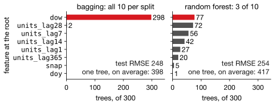
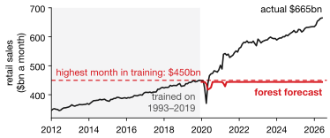

## Lecture Outline

1. From Single Trees to Ensembles
2. Bagging: Bootstrap Aggregating
3. Random Forests: Decorrelating the Trees
4. Feature Importance and Interpretation
5. Gradient Boosting
6. XGBoost
7. Key Takeaways

# From Single Trees to Ensembles

Averaging many imperfect models can outperform any single model.

---

## The Wisdom of Crowds

A single expert can be wrong. Average many *independent* estimates and the errors tend to cancel.

::: {.examplebox}
::: {.examplebox-title}
Classic Example: Guessing the Ox's Weight
:::
At a 1907 county fair, 800 people guessed the weight of an ox. No individual was very accurate — but the **average of all 800 guesses** came within one pound of the true weight.
:::

Models work the same way. One tree is unstable, Lecture 4's closing complaint. Average many trees fitted to different versions of the data and the noise largely cancels while the signal survives.

**Ensembles work because independent errors cancel.** The more independent the trees, the more averaging removes: the difference between bagging and random forests turns on that word.

# Bagging: Bootstrap Aggregating

Train many trees on bootstrap samples; average their predictions.

---

## Bagging: The Big Idea

**Problem from Lecture 4:** one tree has high variance. **Bagging** [@Breiman1996] averages it away:

1. Draw $B$ **bootstrap samples** (with replacement, the same size as the data)
2. Fit one deep decision tree to each
3. **Average** the $B$ predictions: $\hat{y}_{\text{bag}} = \tfrac{1}{B}\sum_{b=1}^{B} \hat{f}^{(b)}(\mathbf{x})$

**Why it works.** With $\rho$ the correlation between two trees' predictions,

$$\mathrm{Var}(\bar{f}) = \rho\sigma^2 + \tfrac{1-\rho}{B}\sigma^2 .$$

More trees shrink the second term; the first never moves. **That floor, $\rho\sigma^2$, is set by how alike the trees are**, not by how many you grow.

---

## Out-of-Bag (OOB) Error: Free Cross-Validation

A bootstrap sample holds about **63%** of the distinct rows; the rest are **out-of-bag** for that tree. Score each row with only the trees that never saw it: an out-of-sample RMSE, no refitting (`oob_score=True`).

::: {.warningbox}
**On a time series it is not a forecast test.** Each row is out-of-bag for about $0.37B$ trees whatever $n$ is; small $n$ is noisy only because there are few rows to average. Worse, those trees trained on the weeks *after* the row: OOB scores filling a gap, not forecasting. Use walk-forward CV.
:::

# Random Forests: Decorrelating the Trees

Restrict each split to a random subset of features so trees are less alike.

---

## The Problem Bagging Does Not Fully Solve

If one feature dominates (`dow` daily, the four-week lag weekly), nearly every bagged tree splits on it first and $\rho$ stays high. **The random forest fix** [@Breiman2001]: at each split, consider only a random $m < p$ of the features.

{fig-align="center" height="340px"}

[Lab 5, 300 trees each. The fix spreads the roots, and its trees average better (417 to 254, against 398 to 248), but they start worse: with one dominant feature among ten, `sqrt` loses.]{.smaller}

---

## Random Forest Hyperparameters

| Parameter | sklearn name | Default | Effect |
|-----------|--------------|---------|--------|
| Number of trees | `n_estimators` | 100 | More = lower variance; plateaus ~500 |
| Max features/split | `max_features` | `1.0` (all) | Lower = more decorrelated |
| Max depth | `max_depth` | None | Limit only to reduce memory |
| Min samples/leaf | `min_samples_leaf` | 1 | Higher = smoother predictions |
| OOB score | `oob_score` | False | `True` gives a free CV estimate |

**The default is plain bagging.** scikit-learn's regressor considers every feature at every split; `'sqrt'` is the classifier's default. So set `max_features` yourself: it is the dial for $\rho$, and the only one that really needs tuning. Start with `n_estimators=500`, `min_samples_leaf=5`.

[Set `random_state=42`: a forest is random twice over, in the bootstrap samples and in the feature subsets.]{.neutral .smaller}

# Feature Importance and Interpretation

Which predictors matter most? RF gives a data-driven answer.

---

## Random Forest Feature Importance [@Molnar2022]

::: {.definitionbox}
::: {.definitionbox-title}
Mean Decrease in Impurity (MDI)
:::
For each feature $j$, average the total reduction in node impurity across every split on $j$, weighted by the fraction of observations reaching that node. Normalize to sum to 1.
:::

| Feature (CA_1 FOODS, weekly) | Importance |
|------------------------------|-----------|
| `units_lag4` | 0.28 |
| `units_lag1` | 0.21 |
| `snap_days` | 0.17 |
| `units_lag52` | 0.15 |
| `units_lag2` | 0.09 |
| `units_lag3` | 0.06 |

From the next slide's forest; Lecture 4's single tree gave the four-week lag 0.62. A screening device only: **MDI is biased** toward features with many split points. `permutation_importance` (shuffle a column, measure the damage) is the honest alternative.

---

## Random Forest in Python

::: {.examplebox}
::: {.examplebox-title}
sklearn Code Template
:::
```python
from sklearn.ensemble import RandomForestRegressor

rf = RandomForestRegressor(n_estimators=500, max_features='sqrt',
                           min_samples_leaf=5, oob_score=True,
                           random_state=42).fit(X_tr, y_tr)
print(rf.oob_score_)
importances = rf.feature_importances_
```
:::

| Model (CA_1 FOODS, 52-week test) | Test RMSE |
|----------------------------------|-----------|
| Seasonal naïve | 1,660 |
| Single deep tree | 1,456 |
| **Random Forest** | **1,115** |

The forest cuts RMSE by **23%** against a single deep tree. Both tree models beat the seasonal naive benchmark, the first in this course to do so on this series.

[What changed is not a better model of the series but a richer feature set — lags, price, and SNAP days are information ETS and ARIMA never had.]{.neutral .smaller}

# Gradient Boosting

Instead of averaging independent trees, fit each new tree to the errors of all previous trees.

---

## Boosting vs. Bagging: The Core Difference

:::: {.columns}
::: {.column width="48%"}
**Bagging (Random Forest):**

- Trees built **in parallel**
- Each tree predicts $y$
- Averaging cuts *variance*
- More trees never cut bias
:::
::: {.column width="48%"}
**Boosting:**

- Trees built **in sequence**
- Each fits the *errors* so far
- Cuts *bias* as well
- Overfits if trees are too deep or too many
:::
::::

**The intuition.** Forecast 1 says \$50,000 against an actual \$60,000; forecast 2 predicts the *error*, +\$10,000, and the sum is right. Each stage corrects what remains, fixing a bias that averaging never touches.

---

## The Gradient Boosting Algorithm

::: {.definitionbox}
::: {.definitionbox-title}
Gradient Boosting (squared-error loss)
:::
Initialize $F_0(\mathbf{x}) = \bar{y}$. For $b = 1, \ldots, B$:

1. Compute residuals: $r_i^{(b)} = y_i - F_{b-1}(\mathbf{x}_i)$
2. Fit a shallow tree $T_b$ to $\{(\mathbf{x}_i, r_i^{(b)})\}$
3. Update: $F_b = F_{b-1} + \eta\, T_b$

Final prediction: $\hat{y} = F_B(\mathbf{x})$
:::

Trees are **shallow** (depth 3 to 6): each captures a little of what remains.

**The learning rate $\eta$ is the main dial:** 0.01–0.1 is slow and robust, above 0.3 risks overshooting. Use a small $\eta$, many trees and **early stopping**, or boosting fits your noise.

# XGBoost

Three improvements over vanilla boosting: second-order optimization, explicit regularization, and column subsampling.

---

## XGBoost: Three Advances [@Chen2016]

1. **Newton step.** Uses the loss's curvature as well as its slope. For squared error the curvature is constant, so this is the ordinary residual fit; it matters for log-loss or Poisson.
2. **Explicit regularization.** Penalties on leaf count and leaf size, inside the objective.
3. **Column subsampling**, borrowed from random forests.

`reg_lambda` is Ridge and `reg_alpha` is LASSO, on leaf weights (next week). `gamma` is a price per leaf, like Lecture 4's `ccp_alpha`.

[XGBoost dominated Kaggle tabular competitions in 2014–2018.]{.neutral .smaller}

---

## XGBoost: Key Hyperparameters

| Parameter | XGB name | Typical | Effect |
|-----------|---------|---------|--------|
| Number of trees | `n_estimators` | 500–2000 | More + small $\eta$ = better |
| Learning rate | `learning_rate` | 0.01–0.1 | Smaller = more robust |
| Tree depth | `max_depth` | 3–6 | Shallow preferred |
| Row subsample | `subsample` | 0.7–0.9 | Fraction of training rows per tree |
| Col. subsample | `colsample_bytree` | 0.7–0.9 | Feature fraction per tree |
| L2 leaf penalty | `reg_lambda` | 1 | Ridge on leaf weights |

::: {.keybox}
**Practical starting point:** `learning_rate=0.05`, `max_depth=4`, `n_estimators=1000` with early stopping on validation RMSE. Tune `max_depth` and `subsample` via `TimeSeriesSplit`.
:::

---

## XGBoost in Python

::: {.examplebox}
::: {.examplebox-title}
Code Template
:::
```python
model = xgb.XGBRegressor(n_estimators=1000, learning_rate=0.05,
                         max_depth=4, subsample=0.8, colsample_bytree=0.8,
                         early_stopping_rounds=50, random_state=42)
model.fit(X_train, y_train, eval_set=[(X_val, y_val)], verbose=False)
```
:::

`eval_set` is what makes `early_stopping_rounds` work: XGBoost watches validation RMSE and halts when it stops improving, which is how you get away with setting `n_estimators` far higher than you need.

**The validation set must respect time.** Build it with `TimeSeriesSplit` and hold out the final stretch as a true test set.

[On macOS `xgboost` also needs OpenMP: `brew install libomp`, or the import fails.]{.neutral .smaller}

# Key Takeaways and Roadmap

Bagging reduces variance; boosting reduces bias. Together they cover most of what tabular forecasting needs.

---

## Tree Methods: Which One When

| Method | Training | Interpretable | Tuning | Accuracy |
|--------|----------|--------------|--------|----------|
| Decision Tree | Single tree | High | Low | Baseline |
| Random Forest | Parallel ($B$ trees) | Medium | Low | Good |
| XGBoost | Sequential ($B$ trees) | Low | Higher | Best |

**Random Forest is the better default**: robust, almost no tuning, OOB error for free. **Move to XGBoost** when you can afford to tune and need the last few points — and budget for that tuning, because an untuned XGBoost often loses to a default forest.

---

## Why No Tree Can Extrapolate

A forest's prediction is a weighted average of training targets, so it can never leave [training min, training max]. A forest trained on US retail sales through 2019, then given each later month's true lags:

{fig-align="center" height="330px"}

[It never forecasts above \$450bn; by mid-2026 sales are \$665bn. Boosted trees go flat beyond their last split too. On a trending series, keep a model that can extrapolate.]{.smaller}

---

## Lecture 5: Key Takeaways

::: {.keybox}
1. **Ensembles** work because independent errors cancel.
2. **Bagging** averages bootstrap trees; variance floors at $\rho\sigma^2$.
3. **Random forests** cut $\rho$ by sampling features at each split — when no single feature dominates.
4. **OOB error** is free, but on a time series it scores gaps, not forecasts.
5. **Boosting** fits each tree to the errors so far: it attacks bias.
6. No tree can **extrapolate** beyond the training range.
7. Tune with `TimeSeriesSplit`; pair boosting with **early stopping**.
:::

*Next: Regularization & Model Selection — choosing among many predictors by shrinking coefficients rather than counting them.*

---

## References

::: {#refs}
:::
