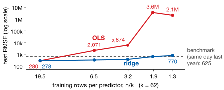
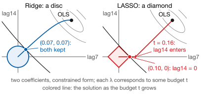
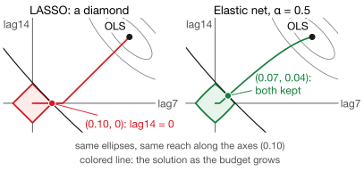
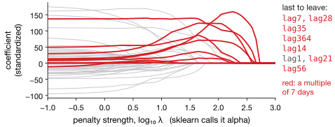

## Lecture Outline

1. The Problem: Too Many Predictors
2. Shrinkage Methods
3. Choosing the Penalty
4. In Practice
5. Key Takeaways and Roadmap

# The Problem: Too Many Predictors

Feature engineering gives us more predictors than we can safely estimate. Something has to decide which ones survive.

---

## Why Regularize?

OLS minimizes $\sum_{i}(y_i - \mathbf{x}_i'\boldsymbol{\beta})^2$ and nothing else. Lab 6 hands it $k = 62$ predictors, then shrinks the training window:

{fig-align="center" height="340px"}

[Same features, same test year. OLS goes from 280 to 3.6 million. Ridge, one line changed, ends at 770, a little worse than the benchmark.]{.smaller}

---

## Regularization: Fit Plus a Penalty

Three things go wrong as $k$ approaches $n$. The variance of $\hat{\boldsymbol{\beta}}$ grows with $k$. Correlated predictors get huge coefficients of opposite sign. Past $k > n$ there is no unique solution.

**Regularization** adds a penalty on coefficient size:

$$
\underbrace{\sum_i (y_i - \hat{y}_i)^2}_{\text{fit}}
+ \underbrace{\lambda \cdot \text{Penalty}(\boldsymbol{\beta})}_{\text{complexity}}
$$

You accept a little bias for a large cut in variance. For a forecast, that trade is almost always worth making.

---

## Subset Selection: The Classical Answer

The classical approach *counts* predictors rather than shrinking them [@Guyon2003].

**Best subset** fits all $2^k$ models: exact, and hopeless past $k \approx 30$. **Stepwise** adds or drops one predictor at a time: greedy, so it can miss the best combination. AIC, BIC or CV picks the winner [@Hyndman2021, §7.5].

::: {.warningbox}
Subset selection is **discrete**: a predictor is in or out, and small changes in the data flip it. The *selected model* is itself high-variance — the instability has moved somewhere harder to see.
:::

[Shrinkage replaces in-or-out with a continuous dial.]{.neutral .smaller}

# Shrinkage Methods

Keep every predictor, but pull its coefficient toward zero.

---

## Ridge Regression ($\ell_2$)

::: {.definitionbox}
::: {.definitionbox-title}
Ridge [@HoerlKennard1970]
:::
$$
\hat{\boldsymbol{\beta}}^{\text{ridge}} = \arg\min_{\boldsymbol{\beta}}
\sum_{i=1}^{n}(y_i - \mathbf{x}_i'\boldsymbol{\beta})^2
+ \lambda \sum_{j=1}^{k} \beta_j^2
$$
:::

Ridge shrinks every coefficient toward zero and sets none exactly to zero: $\lambda = 0$ is OLS, and $\lambda \to \infty$ sends every $\beta_j \to 0$. Two correlated predictors split the effect between them instead of fighting over it.

**Use it when** most predictors carry a little signal and you want to keep them all.

**Standardize first.** The penalty is not scale-invariant: the same predictor in dollars and in thousands of dollars is penalized differently, and the units decide what survives.

---

## LASSO ($\ell_1$)

::: {.definitionbox}
::: {.definitionbox-title}
LASSO [@Tibshirani1996]
:::
$$
\hat{\boldsymbol{\beta}}^{\text{lasso}} = \arg\min_{\boldsymbol{\beta}}
\sum_{i=1}^{n}(y_i - \mathbf{x}_i'\boldsymbol{\beta})^2
+ \lambda \sum_{j=1}^{k} |\beta_j|
$$
:::

Swap the square for an absolute value and LASSO sets some coefficients **exactly** to zero: selection and estimation in one step, and a sparse model you can read aloud to a stakeholder.

**Use it when** only a handful of predictors genuinely matter and you want the model to say which.

**But be careful what you conclude.** Among highly correlated predictors LASSO keeps *one*, more or less arbitrarily. The survivor is not "the important one"; it won a coin toss between near-identical variables.

---

## Why LASSO Zeros Out and Ridge Does Not

Both minimize squared error subject to a budget $t$: $\sum_j \beta_j^2 \le t$ or $\sum_j |\beta_j| \le t$. Ellipses of equal error grow from OLS until they touch the budget. Lab 6's lag7 and lag14, standardized:

{fig-align="center" height="330px"}

[The disc has no corners, so Ridge keeps both. The diamond's corner zeros lag14, but only while $t < 0.16$, a fifth of OLS's $\sum_j |\hat{\beta}_j| = 0.84$: these lags are nearly interchangeable, so the ellipses run almost along its face. A zero means "not worth its budget here," not "proven irrelevant" [@James2021, §6.2].]{.smaller}

---

## Elastic Net: Both Penalties at Once

::: {.definitionbox}
::: {.definitionbox-title}
Elastic Net [@ZouHastie2005]
:::
$$
\sum_{i=1}^{n}(y_i - \mathbf{x}_i'\boldsymbol{\beta})^2 + \lambda \left[ \alpha \sum_j |\beta_j|
+ (1-\alpha) \sum_j \beta_j^2 \right]
$$

$\lambda$ sets the total penalty; $\alpha \in [0,1]$ sets the mix ($\alpha=1$ is LASSO, $\alpha=0$ is Ridge).
:::

The mix keeps LASSO's ability to zero out predictors while adding Ridge's **grouping effect**: correlated predictors now enter or leave together instead of one surviving arbitrarily.

**This is usually the right default for forecasting.** Lagged predictors are correlated almost by construction — $y_{t-1}$ and $y_{t-2}$ move together — which is precisely the situation where pure LASSO picks a winner at random and pure Ridge refuses to simplify.

---

## The Grouping Effect, Drawn

The diamond again, beside the elastic-net ball at $\alpha = 0.5$, on the same ellipses and with the same reach along the axes:

{fig-align="center" height="330px"}

[The ball is pointed only on the axes and curved everywhere else. At this budget the bend is slight, yet it moves the touch point off the corner. Its corner still zeros lag14, but only while the reach is below 0.02, against LASSO's 0.16.]{.smaller}

# Choosing the Penalty

$\lambda$ is not estimated from the model. It is tuned — and how you tune it decides whether the model generalizes.

---

## The Regularization Path

Fit across a grid of $\lambda$ and trace each coefficient: Lab 6's LASSO, all 62 features. They shrink, then drop to zero one at a time, until only the mean forecast is left.

{fig-align="center" height="320px"}

[**The order in which predictors leave is the useful output.** Seven of the last eight are multiples of 7: the model also had day-of-week dummies, yet under heavy penalty it kept the weekly lags and dropped the dummies. Report that ordering, not one model's coefficient table.]{.smaller}

---

## Choosing $\lambda$ by Cross-Validation

1. Define a grid of $\lambda$, usually log-spaced
2. For each $\lambda$, run walk-forward CV, recording the mean validation RMSE
3. Pick the $\lambda$ minimizing CV error, then refit on all training data

**The one-standard-error rule:** take the *largest* $\lambda$ whose CV error is within one standard error of the minimum. You give up almost no accuracy for a simpler model.

::: {.warningbox}
**Default to `TimeSeriesSplit`**, as in Lecture 1. Random `KFold` trains on the future to validate the past: valid for a pure autoregression with uncorrelated errors [@Bergmeir2018], not under trend or serial correlation.
:::

# In Practice

Standardize, tune on a time-aware split, and read the path.

---

## Regularization in Python

::: {.examplebox}
::: {.examplebox-title}
Code Template
:::
```python
from sklearn.linear_model import ElasticNetCV
from sklearn.pipeline import make_pipeline
from sklearn.preprocessing import StandardScaler
from sklearn.model_selection import TimeSeriesSplit

model = make_pipeline(
    StandardScaler(),
    ElasticNetCV(l1_ratio=[.1, .5, .7, .9, .95, 1],
                 cv=TimeSeriesSplit(5), random_state=42)
).fit(X_tr, y_tr)
```
:::

`make_pipeline` is the part that matters: it keeps standardization *inside* each CV fold. Scale on the full sample and you have leaked the validation set into training, and your CV error is optimistic.

`l1_ratio` is the Ridge/LASSO mix; it equals $\alpha$ only at 0 and 1, since `sklearn` halves the $\ell_2$ term. `...CV` tunes $\lambda$, which `sklearn` calls `alpha`.


# Key Takeaways and Roadmap

Shrinkage is the linear-model counterpart to what trees do by pruning.

---

## Linear Methods: Which One When

| Method | Penalty | Zeros out? | Best when |
|--------|---------|-----------|-----------|
| OLS | none | no | $k \ll n$, predictors uncorrelated |
| Stepwise | discrete | yes | Few candidate predictors, need a story |
| Ridge | $\ell_2$ | no | Many predictors, all mildly useful |
| LASSO | $\ell_1$ | yes | Few predictors truly matter |
| Elastic Net | both | yes | Many *correlated* predictors |

**Connection to Lecture 5.** Trees and shrinkage solve the same problem in different geometries. XGBoost's `reg_lambda` is literally a Ridge penalty on leaf weights (`reg_alpha` is the LASSO one), and `gamma` charges a fixed price per leaf, like pruning's $\alpha$ in Lecture 4. Regularization is how every flexible model is kept honest.

---

## Lecture 6: Key Takeaways

::: {.keybox}
1. With many predictors OLS overfits; past $k > n$ it has no unique solution.

2. **Subset selection** is discrete, greedy and unstable.

3. **Shrinkage** is a dial. Ridge shrinks all; LASSO's corners zero some, at small enough budgets; Elastic Net keeps correlated predictors together.

4. **Standardize** inside each CV fold, and **tune $\lambda$** with `TimeSeriesSplit`, never random $K$-fold.

5. The **regularization path**, the order predictors drop out, is more stable than any one coefficient table.
:::

*Next: neural networks, where the fit-plus-penalty skeleton of Lectures 3–6 returns as weight decay.*

---

## References

::: {#refs}
:::
