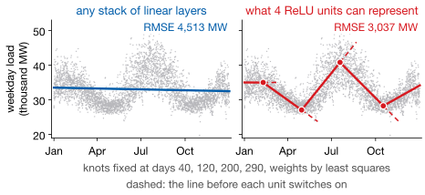

## Lecture Outline

1. From Trees to Neural Networks
2. Feedforward Networks
3. Training: Loss and Backpropagation
4. PyTorch Implementation
5. Key Takeaways

# From Trees to Neural Networks

Trees predict in steps. Networks predict in curves — and that difference buys less than you would expect on tabular data, and everything on sequences.

---

## Why Go Beyond Trees?

A tree treats rows as independent: time enters only as the lag columns you built. Its prediction is **piecewise constant**, so in Lab 4 it could not predict above the largest value it had seen.

A network's prediction is **continuous** — with ReLU, piecewise linear.

::: {.warningbox}
**This is not an upgrade.** On Homeworks 3 and 4, boosting and a tuned LASSO were hard to beat; a network often loses to both. Reach for one for *sequences*, images or audio, or very large $n$.
:::

---

## From Linear Regression to a Single Neuron

Start from something you already know. Linear regression predicts $\hat{y} = \mathbf{w}^\top \mathbf{x} + b$.

A **neuron** is that same expression with one addition — a nonlinear **activation** $\sigma(\cdot)$ wrapped around it:

$$a = \sigma(\mathbf{w}^\top \mathbf{x} + b)$$

| Activation | Formula | Where it is used |
|---|---|---|
| ReLU | $\max(0,z)$ | Hidden layers — the default |
| Sigmoid | $1/(1+e^{-z})$ | Binary outputs, and LSTM gates (Lecture 9) |
| Tanh | $\tanh(z)$ | Sequence states |
| Linear | $z$ | The output layer, for regression |

ReLU makes the intuition literal: the neuron asks *"is this pattern present?"* If the evidence is positive it passes a signal through; if not it outputs exactly zero and stays silent.

---

## Why the Nonlinearity Is the Whole Trick

Depth alone buys nothing: a linear function of a linear function is linear, $\mathbf{W}_2(\mathbf{W}_1\mathbf{x}) = (\mathbf{W}_2\mathbf{W}_1)\mathbf{x}$. Weekday electricity load against the day of the year:

{fig-align="center" height="340px"}

[With one input, a hidden layer of $H$ ReLU units draws a continuous, piecewise-linear curve with at most $H$ kinks: a linear spline whose knots the network learns. Prophet's trend (Lecture 3) is the same sum, with its changepoints fixed in advance.]{.smaller}

---

## Universal Approximation: Existence, Not Estimation

Add units and the kinks multiply. With enough of them, one hidden layer can approximate *any* continuous function arbitrarily well: the **universal approximation theorem**.

**Read it carefully.** It says a network *can* represent the function — not that your optimizer will find it, that you have the data to identify it, or that it will generalize.

Four units already reach RMSE 3,037 on the electricity year, and no function of the day of the year fits better than 2,864. Past that, capacity is not what is missing.

# Feedforward Networks

Stack layers of neurons, and each layer learns a higher-level representation of the one below it.

---

## Feedforward Network: Layers and Forward Pass

A **feedforward network** (FFN, or multilayer perceptron) is three things in sequence: an **input layer** of features $\mathbf{x} \in \mathbb{R}^p$; **hidden layers**, each applying $\mathbf{a}^{(\ell)} = \sigma\!\left(\mathbf{W}^{(\ell)}\mathbf{a}^{(\ell-1)} + \mathbf{b}^{(\ell)}\right)$; and a linear **output layer** for regression.

**Width** is the number of neurons in a layer, **depth** the number of hidden layers.

::: {.keybox}
**Sensible starting sizes for forecasting:** 2–3 hidden layers, 64–256 neurons each, ReLU, dropout 0.2–0.5. Start at the small end of every range.
:::

Add capacity only when validation error says the model is too simple.

---

## How Big Is This Model, Actually?

Capacity is easy to add by accident, so count it once: a layer mapping $m$ inputs to $n$ outputs holds $m \times n$ weights plus $n$ biases. Our weekly panel, 46 engineered features in, two hidden layers of 128, one output:

| Layer | Shape | Parameters |
|---|---:|---:|
| Input $\rightarrow$ hidden 1 | $46 \times 128$ | 6,016 |
| Hidden 1 $\rightarrow$ hidden 2 | $128 \times 128$ | 16,512 |
| Hidden 2 $\rightarrow$ output | $128 \times 1$ | 129 |
| **Total** | | **22,657** |

[**Twenty-two thousand parameters on five thousand rows** — four per observation.]{.key-result}

Lecture 6 called sixty predictors on a hundred and fifty observations a crisis. Networks train far past that ratio routinely; what makes it survivable is the regularization, next.

# Training: Loss and Backpropagation

Compute the error, propagate it backward, adjust every weight by its share of the blame. Repeat.

---

## Training: Loss, Gradients, and the Update Step

Training is one loop. **First**, the loss: for regression, mean squared error $\mathcal{L} = \frac{1}{n}\sum_i (y_i - \hat{y}_i)^2$. **Second, backpropagation:** the chain rule, run backward, gives each weight its share of the error. **Third**, step every weight against its gradient:

$$\mathbf{W} \leftarrow \mathbf{W} - \eta \, \frac{\partial \mathcal{L}}{\partial \mathbf{W}}, \qquad \eta = \text{learning rate}$$

::: {.definitionbox}
::: {.definitionbox-title}
Stochastic gradient descent
:::
Update on a **mini-batch** of 32–256 rows, not the whole dataset: noisier steps, far more of them, much faster. One pass through every batch is an **epoch**.
:::

**You never differentiate by hand:** `loss.backward()` does it, and `torch.optim.Adam(lr=1e-3)` adapts the step size per parameter.

---

## Preventing Overfitting — Where Lecture 6 Returns

Twenty-two thousand parameters on five thousand rows will memorize the training set unless something stops it. Three things do, and **you have met two of them already**.

| | |
|---|---|
| `weight_decay` | **This is Ridge.** An $\ell_2$ penalty on the weights, under a different name. `Adam(..., weight_decay=1e-4)` |
| `nn.Dropout(p)` | Randomly zero a fraction $p$ of neuron outputs on each forward pass, so no neuron can depend on a specific other one being present. All neurons are active at test time. |
| Early stopping | Watch validation loss each epoch; stop when it has not improved for $k$ epochs, and keep the weights from the *best* epoch, not the last. |

[**That is the fifth appearance of one idea.**]{.hi} The GAM smoothing penalty in Lecture 3, cost-complexity pruning in Lecture 4, `reg_lambda` on leaf weights in Lecture 5, Ridge and LASSO in Lecture 6 — and now weight decay. Fit against complexity, one parameter setting the exchange rate, chosen by validation.

# PyTorch Implementation

Four pieces: a Dataset, a DataLoader, a model, and a training loop.

---

## PyTorch: Dataset and DataLoader

::: {.examplebox}
::: {.examplebox-title}
Wrapping your arrays
:::
```python
from torch.utils.data import Dataset, DataLoader

class ForecastDataset(Dataset):
    def __init__(self, X, y):
        self.X = torch.tensor(X, dtype=torch.float32)
        self.y = torch.tensor(y, dtype=torch.float32)
    def __len__(self): return len(self.X)
    def __getitem__(self, i): return self.X[i], self.y[i]

loader = DataLoader(ForecastDataset(X_tr, y_tr),
                    batch_size=64, shuffle=False)
```
:::

`Dataset` fetches *one* example; `DataLoader` batches.

**`shuffle=False`** keeps runs identical. Shuffling these training windows would not leak the future — each carries its own past; shuffling *before* the time split would.

---

## PyTorch: Defining the Model

::: {.examplebox}
::: {.examplebox-title}
A two-layer network with dropout
:::
```python
import torch.nn as nn

model = nn.Sequential(
    nn.Linear(n_features, 128), nn.ReLU(), nn.Dropout(0.3),
    nn.Linear(128, 128),        nn.ReLU(), nn.Dropout(0.3),
    nn.Linear(128, 1))
```
:::

Read it top to bottom and it is the diagram: a linear map, a nonlinearity, some dropout, again, then a linear output with no activation because this is regression.

`nn.Sequential` chains layers in order and is enough for anything in this lecture. When an architecture needs branching or a skip connection — Lecture 8 — you subclass `nn.Module` and write `forward()` yourself.

[`nn.Linear(in, out)` holds the weight matrix and bias for one layer. That is where the 22,657 parameters live.]{.neutral .smaller}

---

## PyTorch: The Training Loop

::: {.examplebox}
::: {.examplebox-title}
The four steps, per mini-batch
:::
```python
opt = torch.optim.Adam(model.parameters(), lr=1e-3, weight_decay=1e-4)
lossfn = nn.MSELoss()

for epoch in range(n_epochs):
    model.train()
    for xb, yb in loader:
        opt.zero_grad()                        # 1 clear old gradients
        loss = lossfn(model(xb).squeeze(), yb) # 2 forward
        loss.backward()                        # 3 backward
        opt.step()                             # 4 update weights
```
:::

Every PyTorch training loop is those four lines with more around them.

**The one that bites:** forget `zero_grad()` and PyTorch *accumulates* gradients rather than replacing them. No error, no warning — just a model that trains badly.

# Key Takeaways

Where a network belongs in the toolkit you now have.

---

## Neural Networks vs. Tree Methods

| Method | Sequences | Extrapolates | Tuning | Best for |
|---|---|---|---|---|
| LASSO / Ridge | no | yes | light | Many correlated predictors |
| Random forest | no | no | light | Tabular, robust default |
| XGBoost | no | no | moderate | Tabular, best-in-class |
| FFN | no | yes | heavy | Smooth functions, large $n$ |
| RNN / LSTM | **yes** | yes | heavy | Sequences (Lecture 9) |

**An FFN on lag features is doing the same job as XGBoost on lag features** — same inputs, same flat table, no notion of order. It is not obviously the better tool, and on the evidence of Homework 4 it usually is not [@James2021].

What changes in the next two lectures is the *architecture*: convolutions that see local structure, and recurrence that carries state through time. That is when the sequence column above starts saying yes, and it is the reason to learn this machinery now.

---

## Lecture 7: Key Takeaways

::: {.keybox}
1. A **neuron** is regression inside a nonlinearity. Without it, layers collapse to one line; with ReLU, each unit adds a kink.

2. Width and depth set an **FFN**'s capacity: 22,657 parameters on 5,000 rows.

3. **Training**: loss $\to$ `backward()` $\to$ `step()`, per mini-batch.

4. **Regularization is not new**: weight decay is Ridge.

5. For time series: split by time, **never shuffle before the split**, call `zero_grad()` every batch.

6. An FFN on engineered features competes with XGBoost; it is **not an upgrade**.
:::

[Next: convolutions, including 1D ones for time series.]{.neutral}

---

## References

::: {#refs}
:::
