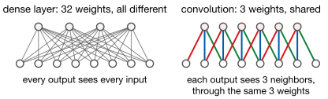
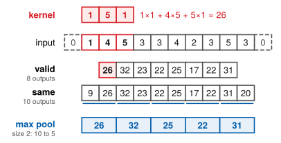
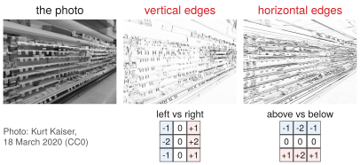
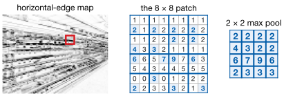
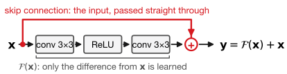
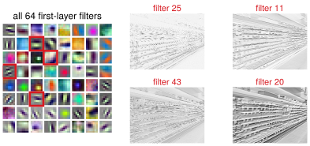
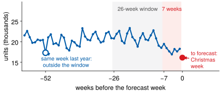

## Lecture Outline

1. Convolution: The Core Idea
2. Pooling and Dropout
3. CNN Architecture Evolution
4. 1D CNNs for Time Series
5. Key Takeaways

# Convolution: The Core Idea

Look at a small window, and look for the same thing everywhere. Two ideas, and they are the whole architecture.

---

## Why Convolution? A Dense Layer Wastes Its Weights

A $224 \times 224$ image has 50,176 pixels. One hidden layer of 1,000 neurons on top of it needs **50 million weights** — for one layer. Lecture 7's whole network had 22,657.

And the waste is worse than the cost. That layer has no idea that **neighboring pixels are related** and distant ones usually are not. And it **cannot reuse what it learns**: a pattern learned in the top-left corner is stored separately from the same pattern in the bottom-right.

---

## Why Convolution? Two Ideas

{fig-align="center" height="230px"}

::: {.keybox}
**Local connectivity:** each neuron sees only a small **receptive field**. **Weight sharing:** the same filter is applied at every position. Far fewer parameters, and a pattern learned anywhere is recognized everywhere.
:::

A reader does not memorize the letter "A" separately for every spot on the page. They learn it once and apply it everywhere. A filter does exactly that.

---

## How a Convolutional Layer Works

For a sequence, a 1D convolution slides a filter of length $K$ along the series and takes a dot product at each position:

$$(f * g)[t] = \sum_{k=0}^{K-1} f[k] \cdot g[t - k]$$

| | |
|---|---|
| **Kernel size** | Filter length $K$. Larger means a wider receptive field — more context per output, and more parameters. |
| **Stride** | How far the filter moves between positions. Stride 2 halves the output length. |
| **Padding** | Zeros at the edges. `padding='same'` keeps output length equal to input length. |
| **Filters** | How many different patterns to learn. This becomes the number of output channels. |

Each filter learns one **local pattern** — an edge, a spike, a seasonal dip. Its output is a **feature map** whose high values mark where that pattern was found.

---

## Convolution, Step by Step

A length-10 series and a width-3 filter $[1, 5, 1]$. Slide the filter along and take a dot product at each position.

{fig-align="center" height="380px"}

[**Valid** keeps only full overlaps: $10 - 3 + 1 = 8$ outputs. **Same** pads a zero at each end and keeps all 10. Max pooling then keeps the larger of each pair.]{.smaller}

---

## What a Filter Sees

The same operation in two dimensions: a $3\times3$ filter slides over every pixel of a photograph. Two hand-set filters find two different kinds of structure.

{fig-align="center" height="400px"}

[18 March 2020: shelves emptied by a shock no forecast saw coming — more in Week 16.]{.neutral .smaller}

# Pooling and Dropout

Pooling shrinks the feature map and buys robustness — at a price that matters more for forecasting than for images.

---

## Pooling: Downsampling Feature Maps

**Pooling** summarizes each small region of a feature map with one number: max pooling keeps the largest, average pooling the mean.

{fig-align="center" height="200px"}

It buys **fewer parameters downstream** and **translation invariance**: shift the input slightly and the pooled output barely changes. The shelf edge survives.

::: {.warningbox}
**A feature for images, a problem for forecasting.** A demand spike that moved three weeks later is what you are predicting, not noise. Pooling discards *where* a pattern occurred — we measure the cost later in this lecture.
:::

# CNN Architecture Evolution

Twenty years of image models, and the three ideas that outlived them.

---

## LeNet to VGG: Depth and Small Filters

**LeNet-5** [@LeCun1998] set the template in 1998: convolution and pooling layers, then dense layers. It read handwritten digits on bank checks.

**VGG** [@Simonyan2015] scaled it up in 2014 with one simplification: *only* $3\times3$ filters, stacked deep. Two stacked $3\times3$ layers see what one $5\times5$ sees, with fewer parameters and an extra nonlinearity.

::: {.keybox}
**The lesson that carried:** depth built from small filters beats width built from large ones — which is why modern architectures are deep and narrow.
:::

VGG's cost: 138 million parameters, mostly in the final dense layers.

---

## Inception and ResNet: Depth That Trains

**Inception** [@Szegedy2015] runs $1\times1$, $3\times3$ and $5\times5$ convolutions *in parallel* and lets the network choose the scale; $1\times1$ convolutions keep the cost down.

**ResNet** [@He2016] fixed a different problem: past some depth, deeper networks got *worse* — not from overfitting, but because gradients faded on the way back. The fix is a **residual** or skip connection:

{fig-align="center" height="150px"}

The $+\,\mathbf{x}$ gives the gradient a direct path backward. It made 100-layer networks trainable, and it is in nearly every deep architecture since — including Lecture 9's.

---

## What a Trained CNN Learns

ResNet-18, trained on 1.2 million labeled images. Nobody designed its first layer — these are the 64 filters it arrived at, and what four of them find in the same photograph.

{fig-align="center" height="390px"}

[Many look like the edge filters we set by hand; the rest detect color. **Learned, not engineered** — the same promise a 1D CNN makes for a time series.]{.smaller}

---

## What Carries Over to Time Series

These architectures were built for images, on problems that look nothing like weekly demand forecasting. Three of their ideas transfer anyway.

| | |
|---|---|
| **Small stacked filters** | A width-3 filter twice sees six weeks of context with far fewer weights than one width-6 filter. |
| **Skip connections** | Same fix for the same problem — gradients that fade through depth. |
| **Learned features** | You stop hand-engineering lag windows and let filters find the local shapes that matter. |

**One idea does not transfer, and it is the one we flagged:** pooling for translation invariance. An image classifier should not care where the cat is. A forecaster usually should care where the spike was.

# 1D CNNs for Time Series

The same machinery, along a time axis — and what it costs.

---

## Why Use a 1D CNN for Forecasting?

A 1D CNN takes a **window** of the recent past — 26 weeks of units, SNAP days, events and price — and predicts the next week. You stop choosing lags: the filters learn which local shapes matter. It is far cheaper than a dense network (weight sharing again), and the same filters serve *every* store-category at once.

{fig-align="center" height="250px"}

**The catch is the receptive field.** Stacked width-5 and width-3 filters see seven weeks; annual seasonality is 52 away. Add dilation, or feed the annual lag in as its own channel.

---

## 1D CNN Forecasting Pipeline in PyTorch

::: {.examplebox}
::: {.examplebox-title}
Window in, one forecast out
:::
```python
import torch.nn as nn

model = nn.Sequential(
    nn.Conv1d(n_channels, 32, kernel_size=5), nn.ReLU(),
    nn.Conv1d(32, 64, kernel_size=3),         nn.ReLU(),
    nn.AdaptiveAvgPool1d(1),   # collapses the time axis
    nn.Flatten(),
    nn.Linear(64, 1))
```
:::

Input shape is `(batch, channels, time)` — note that channels come *before* time, which is the transpose of how the data naturally sits in a dataframe.

Everything from Lecture 7 still applies: Adam with weight decay, `zero_grad()` every batch, `shuffle=False`, and a split by time rather than at random.

[`AdaptiveAvgPool1d(1)` averages across the whole time axis. Watch what that does on the next slide.]{.neutral .smaller}

---

## Does It Actually Work?

Fitted on our weekly panel — 26-week windows, four channels, 30 store-category series, the same test block as Homework 4.

| Model | Test RMSE | Parameters |
|---|---:|---:|
| LASSO (Homework 4) | **744** | 46 |
| XGBoost (Homework 4) | 781 | — |
| Random forest (Homework 3) | 899 | — |
| 1D CNN, flatten head | 1,032 | 8,161 |
| 1D CNN, global max pool | 1,418 | 6,945 |
| 1D CNN, global average pool | 1,534 | 6,945 |
| Seasonal naive | 2,152 | 0 |

[**Every CNN variant loses to a 46-coefficient linear model**]{.key-result} — a seven-week receptive field cannot see the annual lag LASSO was handed directly.

And swapping average pooling for `Flatten`, which keeps *where* each pattern occurred, is worth about **500 RMSE** — three seeds each, against a spread of about 80.

# Key Takeaways

---

## CNN Architecture Summary

| Architecture | Year | The idea that survived |
|---|---|---|
| LeNet-5 | 1998 | Conv–pool–conv–pool–dense: the template |
| VGG | 2014 | Only $3\times3$ filters, stacked deep |
| Inception | 2014 | Parallel filter sizes; $1\times1$ to cut channels |
| ResNet | 2015 | Skip connections make real depth trainable |
| 1D CNN | — | The same machinery along a time axis |

**Reach for a 1D CNN** when local shape matters more than exact position, when you have many parallel series, or as a cheap feature extractor feeding something else.

**Do not reach for one** when the dominant signal is at a long lag, when you have well engineered tabular features already, or when a stakeholder needs to read the model. On the evidence above, that covers most of what we forecast in this course.

---

## Lecture 8: Key Takeaways

::: {.keybox}
1. **Convolution** = local connectivity + weight sharing: learn a pattern once, find it everywhere.

2. **Pooling** buys translation invariance — which images want and forecasts usually don't. Cost here: about 500 RMSE.

3. Three ideas outlived the architectures: **small filters stacked deep**, **skip connections**, **learned features**.

4. A **1D CNN**'s limit is its **receptive field**: seven weeks cannot see an annual lag.

5. Every CNN variant **lost to a 46-coefficient LASSO**. Fit the architecture to the problem.
:::

[Next: RNNs and LSTMs — built to carry state through time.]{.neutral}

---

## References

::: {#refs}
:::
