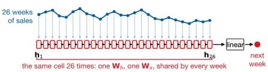
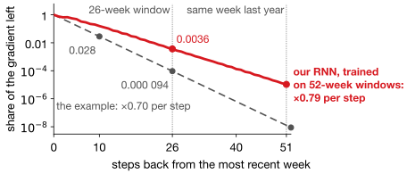
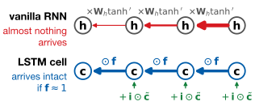
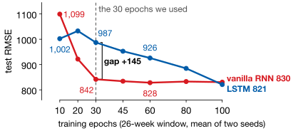
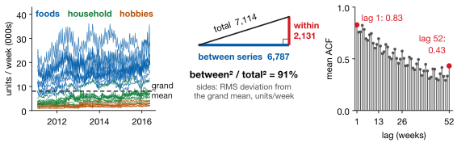

## Lecture Outline

1. Where the Last Two Lectures Ran Out
2. The Vanilla RNN
3. LSTM: Long Short-Term Memory
4. In PyTorch, and Does It Work
5. Key Takeaways

# Where the Last Two Lectures Ran Out

Two architectures, two different ways of failing to see time.

---

## Two Architectures That Cannot See Time

Lecture 7's feedforward network treats each row independently: everything it knows about *when*, you encoded by hand as lag columns.

Lecture 8's 1D CNN sees local shape, but its **receptive field** stops at about seven weeks, and pooling threw away *where* each pattern occurred — a measured 500 RMSE.

::: {.keybox}
Both treat the input as a **fixed-size block**, processed all at once. Neither reads a sequence *in order*, carrying something forward. That is the gap today closes.
:::

---

## The Recurrent Idea: Carry State Forward

A recurrent network reads the sequence one step at a time, keeping a **hidden state** $\mathbf{h}_t$: a running summary of everything so far. Each step updates the summary from the new input *and* the old summary, with the same weights every step — weight sharing again, along time instead of space.

**The promise:** no fixed window. In principle $\mathbf{h}_t$ carries the whole history.

**In principle.** Most of this lecture is about the gap between that promise and what a recurrent network delivers — and the architecture built to close it.

# The Vanilla RNN

One equation, applied over and over — and the reason that is both the whole idea and the whole problem.

---

## Vanilla RNN: One Equation, Repeated

::: {.definitionbox}
::: {.definitionbox-title}
The recurrence
:::
$$\mathbf{h}_t = \tanh\!\left(\mathbf{W}_h \mathbf{h}_{t-1} + \mathbf{W}_x \mathbf{x}_t + \mathbf{b}\right),
\qquad \hat{y}_t = \mathbf{W}_y \mathbf{h}_t + \mathbf{b}_y$$
:::

{fig-align="center" height="230px"}

In words: the new summary is a squashed mix of the old summary and the new week. Shared weights mean a 26-week window costs no more parameters than a 5-week one — about **4,500** here, against 22,657 for Lecture 7's network.

---

## Training It: Backpropagation Through Time

Training is ordinary backpropagation on an unusual graph. **Unroll** the recurrence and it is a 26-layer network, one layer per week, every layer sharing the same weights. Gradients flow back from step $T$ to step 1, and $\mathbf{W}_h$'s gradient sums contributions from all 26.

::: {.warningbox}
**This is where it breaks.** Going back $k$ steps multiplies by $\mathbf{W}_h$ and by $\tanh' \le 1$, $k$ times. Below 1, the gradient shrinks *exponentially*; above 1, it can explode.
:::

Exploding is fixed by `clip_grad_norm_`; vanishing is not — the next section.

---

## Why a Vanilla RNN Forgets [@Bengio1994]

Suppose each backward step multiplies the gradient by $0.7$ — an unremarkable value for a $\tanh$ network — and compare our own RNN, trained on 52-week windows, measured:

{fig-align="center" height="330px"}

**The same factor every step is a straight line on a log scale.** Past the first few steps, ours keeps about $0.79$ a step; measured, **0.4%** of the gradient reaches 26 weeks back, **0.001%** the same week last year. **Bengio and colleagues** proved this is inherent to the architecture.

# LSTM: Long Short-Term Memory

Add a memory that information passes through rather than being recomputed at every step.

---

## LSTM: A Cell State and Three Gates

An LSTM carries **two** things forward: a **cell state** $\mathbf{c}_t$, which is the long-term memory, and a **hidden state** $\mathbf{h}_t$, which is what the rest of the network sees. Three gates control the traffic between them [@Hochreiter1997; @Gers2000].

| | |
|---|---|
| **Forget gate** | $\mathbf{f}_t = \sigma(\mathbf{W}_f[\mathbf{h}_{t-1}, \mathbf{x}_t] + \mathbf{b}_f)$ — what fraction of the old memory to keep |
| **Input gate** | $\mathbf{i}_t = \sigma(\mathbf{W}_i[\mathbf{h}_{t-1}, \mathbf{x}_t] + \mathbf{b}_i)$ — how much of the new candidate to write |
| **Output gate** | $\mathbf{o}_t = \sigma(\mathbf{W}_o[\mathbf{h}_{t-1}, \mathbf{x}_t] + \mathbf{b}_o)$ — how much of memory to expose |
| **Candidate** | $\tilde{\mathbf{c}}_t = \tanh(\mathbf{W}_c[\mathbf{h}_{t-1}, \mathbf{x}_t] + \mathbf{b}_c)$ — the new content on offer |

The memory update itself is the line that matters:

$$\mathbf{c}_t = \mathbf{f}_t \odot \mathbf{c}_{t-1} \;+\; \mathbf{i}_t \odot \tilde{\mathbf{c}}_t,
\qquad \mathbf{h}_t = \mathbf{o}_t \odot \tanh(\mathbf{c}_t)$$

Here $\sigma$ is the sigmoid, so each gate outputs between 0 and 1 — a soft switch the network learns. $[\mathbf{h}_{t-1}, \mathbf{x}_t]$ stacks the two vectors; $\odot$ multiplies element by element.

---

## What the Gates Are Doing, in Plain Terms

The equations are compact but the behavior is intuitive. Take a store forecasting demand week by week.

| | |
|---|---|
| **Forget** | "The promotion that ran three months ago no longer explains anything — drop it." The gate closes toward 0 and that part of memory decays away. |
| **Input** | "This week is Thanksgiving and the spike is enormous — record it." The gate opens toward 1 and the event is written into the cell. |
| **Output** | "I am holding a memory of last December, but this week is April — do not act on it yet." Information stays in $\mathbf{c}_t$ without contaminating the current prediction. |

**The output gate is the one people skip, and it is the subtle one.** It separates *what the model remembers* from *what the model uses right now*. A vanilla RNN cannot make that distinction — its single hidden state has to serve both jobs at once, so anything it stores is immediately in play.

---

## Why the Cell State Fixes the Gradient

Follow a gradient backward through $\mathbf{c}_t = \mathbf{f}_t \odot \mathbf{c}_{t-1} + \mathbf{i}_t \odot \tilde{\mathbf{c}}_t$. Repeated multiplication shrinks; repeated addition does not.

{fig-align="center" height="250px"}

::: {.keybox}
**You have seen this fix before:** Lecture 8's skip connection, $\mathbf{y} = \mathcal{F}(\mathbf{x}) + \mathbf{x}$. The 1997 LSTM had no forget gate, so its cell path *was* that identity, eighteen years before ResNet; the forget gate (2000) made it learnable.
:::

[On our panel the median forget gate is 0.52, so 7% survives four weeks. Check 2 says why.]{.neutral .smaller}

# In PyTorch, and Does It Work

Four lines of model code, and an honest measurement against everything else this course has fitted.

---

## LSTM for Forecasting in PyTorch

::: {.examplebox}
::: {.examplebox-title}
Window in, one forecast out
:::
```python
class LSTMForecaster(nn.Module):
    def __init__(self, n_features, hidden=64, layers=1):
        super().__init__()
        self.lstm = nn.LSTM(n_features, hidden, num_layers=layers,
                            batch_first=True)
        self.fc = nn.Linear(hidden, 1)

    def forward(self, x):        # x: (batch, seq_len, n_features)
        out, (h, c) = self.lstm(x)   # nn.RNN instead: out, h = self.rnn(x)
        return self.fc(out[:, -1, :]).squeeze(-1)
```
:::

`batch_first=True` gives shape `(batch, seq_len, features)` — the *opposite* of `Conv1d`. `out[:, -1, :]` is the state after the last step. Lecture 7's rules still hold, plus `clip_grad_norm_(..., 1.0)`.

---

## Does It Work? The Scoreboard So Far

Same weekly panel, same 26-week windows, same test block as Homework 4.

| Model | Test RMSE | Parameters |
|---|---:|---:|
| LASSO, 46 engineered features | **744** | 46 |
| XGBoost, 46 engineered features | 781 | — |
| **Vanilla RNN**, 4 raw channels | **842** | 4,545 |
| Random forest | 899 | — |
| **LSTM**, 4 raw channels | 987 | 17,985 |
| 1D CNN, best variant | 1,032 | 8,161 |
| Seasonal naive | 2,152 | 0 |

[**Recurrence beats convolution decisively**]{.key-result} — and it did so on *four raw channels* with no lag engineering at all, against 46 hand-built features for LASSO. That is the case for reading a sequence in order, in one line.

**And the LSTM lost to the vanilla RNN** — at a fixed 30-epoch budget. That is not a typo, and the next four slides are about what it does and does not mean.

---

## Why the Gated Model Lost at 30 Epochs

All three windows share one panel and one split: one finding measured three ways, not three tests.

| Window | Vanilla RNN | LSTM | |
|---|---:|---:|---|
| 13 weeks | **878** | 990 | RNN wins |
| 26 weeks | **842** | 987 | RNN wins |
| 52 weeks | **805** | 998 | RNN wins |

**An LSTM solves a problem this data does not have**: gating preserves information across *long* chains, and weekly demand is dominated by the recent past. The gates cost **17,985 parameters against 4,545**. Two checks first: **was the comparison fair**, and **what in the data explains it**?

::: {.warningbox}
A margin measured at one training budget is a claim about that budget — and 30 epochs was just the default.
:::

---

## Check 1: Was It a Fair Fight?

Bigger models converge slower, and the LSTM has 4× the parameters. Vary the **budget**:

{fig-align="center" height="330px"}

::: {.keybox}
At 30 epochs the RNN wins by a wide margin. By 100 the two **tie**, and the LSTM is still improving: we ran out of patience, not the model. The RNN's real edge is speed — **three times faster on a quarter of the parameters** — not a verdict on gating.
:::

---

## Check 2: What in the Data Explains It

Gating pays when a value must survive many steps that would otherwise overwrite it. Does this panel have that?

{fig-align="center" height="320px"}

**1. Most variance is not sequential.** **91%** is *between* series: the task is reading the level, and the last few weeks give you that.

**2. History helps, but it arrives smoothly.** A longer window still improves the RNN (878 → 805), but no value has to survive many steps untouched.

---

## Check 2, Continued: Nothing Arrives Early

**3. Nothing arrives early.** `snap_days` correlates +0.14 with units in the same week. Its −0.13 and +0.12 two and four weeks ahead only echo that through the monthly SNAP calendar, and `event_days` is flat everywhere. No *announcement* structure — exactly what a forget gate is for.

::: {.keybox}
Ask these of your own series before reaching for a gated model: How much of my variance is cross-sectional? Do recent values already summarize old ones? Does anything in my inputs **lead** the target?
:::


# Key Takeaways

What recurrence buys, what it costs, and what is still missing.

---

## RNN and LSTM in Context

| Architecture | Sees order? | Effective memory | Cost |
|---|---|---|---|
| FFN on lags | no | whatever you engineered | cheap |
| 1D CNN | local only | receptive field ($\sim$7 steps) | cheap |
| Vanilla RNN | yes | $\sim$10–30 steps in practice | cheap |
| LSTM | yes | hundreds of steps | 4$\times$ an RNN |

An LSTM holds about **four times** an RNN's parameters at the same hidden size: three gates and the candidate each need a weight matrix. On a short window you pay that for nothing.

**Still missing:** an LSTM reads strictly left to right, so it cannot be parallelized, and everything about step 3 must squeeze through every state between 3 and $T$. Part 2 removes both.

---

## Lecture 9, Part 1: Key Takeaways

::: {.keybox}
1. A **recurrent network** reads in order, carrying a hidden state.

2. **Backpropagation through time** multiplies at every step, so the gradient shrinks exponentially — ours keeps 0.001% of it a year back.

3. An **LSTM**'s cell state is updated **additively**: the ResNet fix, eighteen years earlier.

4. Three gates: **forget** the stale, **input** the new, **output** what matters now.

5. Both **beat every CNN**; both lose to a 46-coefficient LASSO.

6. The LSTM **lost at 30 epochs and tied by 100**. Check a margin survives the training budget.
:::

---

## References

::: {#refs}
:::
