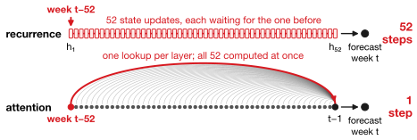
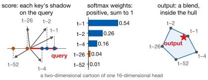
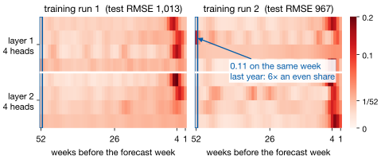
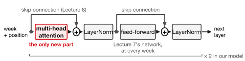
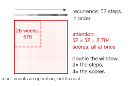

## Lecture Outline

1. What Recurrence Could Not Do
2. The Attention Mechanism
3. The Transformer Encoder
4. Transformers for Time Series
5. Key Takeaways

# What Recurrence Could Not Do

Two constraints that are built into reading a sequence one step at a time.

---

## Two Problems Built Into Recurrence

Part 1's forecaster reads strictly left to right. Follow one week, $t-52$, to the forecast:

{fig-align="center" height="290px"}

[**The information bottleneck:** week $t-52$ must survive 52 squeezes through one 64-number state.\
**The sequential bottleneck:** each update waits for the last, however many GPUs you own.]{.smaller}

::: {.keybox}
**Attention removes both at once:** every week reads every other directly, and all are computed together. Path length counts operations, not what a trained model uses.
:::


# The Attention Mechanism

A learned, weighted lookup — which is a more useful way to read it than the formula suggests.

---

## Scaled Dot-Product Attention [@Vaswani2017]

$$\text{Attention}(Q, K, V) = \text{softmax}\!\left(\frac{QK^\top}{\sqrt{d_k}}\right) V$$

Each week's **query** is scored against every week's **key**, and the scores weight the **values**; $Q$, $K$, $V$ are learned projections of the same weeks, $d_k$ the key length.

{fig-align="center" height="270px"}

[The score is the query's length times the key's shadow on it. Softmax turns the scores into positive weights that sum to one, so the output stays *inside* the values. Attention averages; it cannot extrapolate. The $\sqrt{d_k}$ keeps the softmax from saturating.]{.smaller}

---

## What That Buys a Forecaster

Attention can weight any week in the window in one step; an RNN needs 52 updates to reach last year. Where our trained model actually looked, over the test year:

{fig-align="center" height="340px"}

[Mostly the last two to seven weeks; in one of two training runs, one head found last year's week. The weights are **learned, not specified** — and they show where the model looked, not what mattered.]{.smaller}

---

## Multi-Head Attention

One attention operation gives one set of weights — one notion of what is relevant. **Multi-head attention** runs $h$ of them in parallel on different learned projections, then concatenates:

$$\text{MultiHead}(Q,K,V) = \text{concat}(\text{head}_1, \ldots, \text{head}_h)\, W^O$$

Each head can specialize. Ours did: most watch the last few weeks, one spreads its weight evenly, and in one run one found the annual lag.

**The cost is a surprise.** Each head works in $d_{\text{model}}/h$ dimensions, so eight heads cost about the same as one full-width head.

[Our model: `nhead=4`, `d_model=64` — four heads of 16 dimensions.]{.neutral .smaller}


# The Transformer Encoder

Attention, plus the three pieces that make it trainable.

---

## The Encoder Block

A Transformer encoder layer is four components in a fixed arrangement:

{fig-align="center" height="250px"}

Stack $N$ of those and you have the encoder. Nothing in the block is new to you except attention itself — the skip connections are ResNet's, LayerNorm rescales each week's vector, and the feed-forward sublayer is the Lecture 7 network applied to every week.

**One thing is conspicuously missing, and it is not an oversight.** Nothing above depends on the *order* of the input.

---

## Positional Encoding: Attention Cannot Tell Time

**Attention ignores order**: shuffle the window and each week's output moves with it; the rest is an unordered bag. A forecaster that cannot tell two weeks ago from thirty is not forecasting.

The fix adds 32 pairs $(\sin \omega_i t,\ \cos \omega_i t)$, $\omega_i = 10000^{-2i/d}$, to each week — each pair a clock hand turning at its own speed:

{fig-align="center" height="240px"}

[Shifting $\Delta$ weeks turns each hand by a fixed angle, so similarity depends only on distance. **We measure what removing it costs at the end.**]{.smaller}

---

## Why Transformers Took Over

:::: {.columns}
::: {.column width="47%"}
**Parallelism.** No score waits for another. More than accuracy, this is why it won.

**Direct long-range paths.** One step, any distance.

**Scale.** It kept improving as parameters and data grew. BERT [@Devlin2019] and GPT are this block, repeated.
:::
::: {.column width="53%"}
{fig-align="center" width="82%"}
:::
::::

[Each cell is one query–key score: $O(T^2)$ time and memory, fine at $T = 52$, painful at $T = 10{,}000$.]{.smaller}

::: {.warningbox}
Every advantage here is about **large data and long sequences**. Hold that against a 52-week window and 5,160 training windows.
:::


# Transformers for Time Series

The implementation, the measurement, and an honest reading of it.

---

## Transformer Encoder in PyTorch

::: {.examplebox}
::: {.examplebox-title}
Minimal forecasting encoder
:::
```python
layer = nn.TransformerEncoderLayer(d_model=64, nhead=4,
          dim_feedforward=128, dropout=0.1, batch_first=True)
self.enc = nn.TransformerEncoder(layer, num_layers=2)
self.inp = nn.Linear(n_features, 64)
self.fc  = nn.Linear(64, 1)

def forward(self, x):
    h = self.inp(x) + self.pe      # position must be added
    return self.fc(self.enc(h)[:, -1, :]).squeeze(-1)
```
:::

`nn.TransformerEncoderLayer` gives you the whole block — but not the positional encoding. You add that yourself, and forgetting is a silent failure.

[Multi-step forecasting also needs a causal mask.]{.neutral .smaller}

---

## Does It Work?

Same weekly panel and test block as everything since Homework 3; every sequence model reads 52-week windows (Part 1's headline 842 and 987 were at 26 weeks).

| Model | Test RMSE | Parameters |
|---|---:|---:|
| LASSO, 46 engineered features | **744** | 46 |
| XGBoost | 781 | — |
| Vanilla RNN | **805** | 4,545 |
| Random forest | 899 | — |
| **Transformer encoder**, 2 layers | **990** | 67,329 |
| LSTM | 998 | 17,985 |
| 1D CNN, best variant (26-week window) | 1,032 | 8,161 |
| Seasonal naive | 2,152 | 0 |

The Transformer beats the CNN and **ties the LSTM** — 990 against 998, a difference far smaller than the run-to-run spread. It loses to a vanilla RNN holding **one-fifteenth** as many parameters, and to a 46-coefficient linear model.

---

## Reading That Result Honestly

Every advantage on the "why Transformers took over" slide is an advantage *at scale*, and this problem has none of the scale.

| | |
|---|---|
| **Parallel computation** | Real, but irrelevant — the RNN trains in seconds either way. |
| **Direct long-range paths** | Worth little when the signal is dominated by recent weeks. |
| **Scales with data** | 5,160 training windows is not the regime where that pays. |

**And positional encoding is doing real work, which we can measure.** Remove it and the model still knows the last week, where it reads out, but sees the other 51 as an unordered bag:

| | |
|---|---:|
| Transformer **with** positional encoding | **990** |
| Transformer **without** positional encoding | 1,282 |

[**292 RMSE**]{.key-result} — dropping it below even the 1D CNN. That gap is what the order of those 51 weeks is worth, and the reason the sinusoids exist.

# Key Takeaways

Six architectures, one series, and what the ranking actually taught us.

---

## Sequence Architecture Comparison

| Architecture | Long range | Parallel | Needs |
|---|---|---|---|
| 1D CNN | receptive field only | yes | modest data |
| Vanilla RNN | $\sim$10–30 steps | no | modest data |
| LSTM | hundreds of steps | no | more data |
| Transformer | unlimited, $O(T^2)$ | **yes** | **much more data** |

**Choose by the structure of your problem, not by recency of the architecture.** Short window and recent-lag signal: a plain RNN, or honestly a linear model. Long sequences, abundant data, dependencies at arbitrary distance: a Transformer, and nothing else comes close.

That second case is language, which is why this architecture reshaped that field and has been slower to displace gradient boosting in tabular forecasting — where the M5 competition was won by gradient-boosted trees, Lecture 5's method.

---

## Lecture 9, Part 2: Key Takeaways

::: {.keybox}
1. **Attention**: score queries against keys, softmax, average the values.

2. Its price is **quadratic**: fine at 52 steps, the central constraint at 10,000.

3. **Multi-head**: several notions of relevance for about the cost of one.

4. An encoder block: attention, **skips**, LayerNorm, feed-forward. Only attention is new.

5. **Attention ignores order**: add position yourself; PyTorch will not.

6. Here it **tied the LSTM** and lost to an RNN **one-fifteenth** its size: it needs scale.
:::

[Next: Bayesian Statistics I — a different answer to what a forecast should tell you.]{.neutral}

---

## References

::: {#refs}
:::
