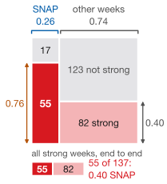
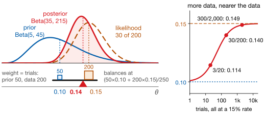
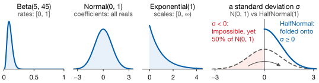
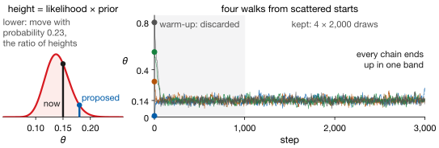
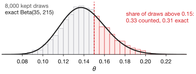
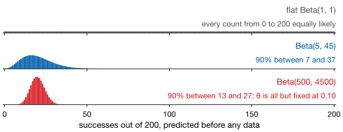

## Lecture Outline

1. Why Bayesian Thinking?
2. Bayes' Theorem
3. Prior Distributions
4. Posterior Inference with PyMC
5. Key Takeaways

# Why Bayesian Thinking?

A different answer to the question of what a forecast should tell you.

---

## Frequentist vs. Bayesian: What Is Random?

The whole difference is which thing you treat as uncertain.

| | Frequentist | Bayesian |
|---|---|---|
| The parameter | A fixed, unknown constant | A quantity you are uncertain about |
| The data | Random — one draw of many possible samples | Fixed — it is what you observed |
| The answer | A point estimate and a standard error | A full distribution over values |
| Prior belief | No formal place for it | Stated explicitly, and updated |

Everything else follows from that first row. If the parameter is fixed, you can only describe how your *estimate* would vary across hypothetical repeated samples. If the parameter is uncertain, you can describe your uncertainty about *it* directly — which is almost always the question someone actually asked.

---

## What This Buys You in a Meeting

A 95% **confidence** interval of $[0.02,\ 0.08]$ does *not* mean a 95% chance the parameter is in it. It means the *procedure* catches the true value in 95% of repeated samples.

A 95% **credible** interval *does* mean that, given your model and data.

::: {.keybox}
One you can say to a decision-maker; the other you keep correcting.
:::

A full distribution also answers a planner's question: *what is the chance we stock out if we order 400 units?*

[The cost: you must state a prior, and defend it.]{.neutral .smaller}

# Bayes' Theorem

One equation, and it is a bookkeeping rule rather than a philosophy.

---

## Bayes' Theorem [@Gelman2013]

::: {.definitionbox}
::: {.definitionbox-title}
The update rule, for an unknown $\theta$ and data $\mathcal{D}$
:::
$$\underbrace{p(\theta \mid \mathcal{D})}_{\text{posterior}} = \frac{\overbrace{p(\mathcal{D} \mid \theta)}^{\text{likelihood}} \cdot \overbrace{p(\theta)}^{\text{prior}}}{\underbrace{p(\mathcal{D})}_{\text{evidence}}}$$
:::

Read it as a sentence. **What I believe after seeing the data** equals **how well each value explains the data**, times **what I believed beforehand**, rescaled to sum to one.

The denominator is only that rescaling — it does not change the *shape*. So the working form is:

$$\text{posterior} \;\propto\; \text{likelihood} \times \text{prior}$$

**You will not compute this by hand**, and this course never asks you to. You are responsible for choosing the prior, checking the sampler worked, and reading the posterior.

---

## Bayes' Theorem, Drawn

CA_1 FOODS, 277 weeks. $\theta$: a SNAP week. $\mathcal{D}$: a **strong** week, above its year's median.

:::: {.columns}
::: {.column width="36%"}
{fig-align="center" width="64%"}
:::
::: {.column width="62%"}
::: {.smaller}
$$
\underbrace{p(\text{SNAP} \mid \text{strong})}_{\text{posterior}}
= \frac{\overbrace{p(\text{strong} \mid \text{SNAP})}^{\text{likelihood}}
        \cdot \overbrace{p(\text{SNAP})}^{\text{prior}}}
       {\underbrace{p(\text{strong})}_{\text{evidence}}}
$$

| | | |
|---|---|---|
| prior | 0.26 | the SNAP column's width |
| likelihood | 0.76 | the crimson block's height |
| likelihood $\times$ prior | 0.20 | the crimson block's area |
| evidence | 0.49 | all strong area, crimson and pink |
| posterior | 0.40 | crimson's share of that area |

76% of SNAP weeks are strong; only 40% of strong weeks are SNAP. **The prior is the width:** a quarter of all weeks.
:::
:::
::::

[The gray 0.40 is $p(\text{strong} \mid \text{other weeks})$, 82 of 205; that it equals the posterior is a coincidence.]{.neutral .smaller}

---

## The Update, in Pictures

A conversion rate $\theta$: a Beta(5, 45) prior, like 5 successes in 50 trials, then 30 in 200.

{fig-align="center" height="370px"}

[Multiply the curves point by point and rescale: the posterior sits between them. Its mean balances the prior's 0.10, worth 50 observations, against the data's 0.15, worth 200, at [**0.14**]{.hi}. With little data the prior does most of the work: a feature when it is defensible, a problem when it is not.]{.smaller}

# Prior Distributions

The part you have to justify, and the part people worry about.

---

## Priors You Will Actually Use

A prior is a distribution over a parameter, chosen to match what that parameter *can* be.

{fig-align="center" height="290px"}

**The support is the first thing to get right.** A Normal prior on a standard deviation puts half its mass on negative values, which are impossible: the model is not wrong so much as incoherent. Fold that half onto $\sigma \ge 0$ and you have the HalfNormal.

---

## Choosing a Prior You Can Defend

The standard objection to Bayesian work is that the prior is arbitrary. The standard answer is that you should not be choosing arbitrary priors.

| | |
|---|---|
| **Weakly informative** | Rules out the absurd, stays agnostic about the plausible. A Normal(0, 1) on a standardized coefficient says "probably not larger than about 2," which is nearly always true and nearly never controversial. **This is the default.** |
| **Informative** | Encodes real prior evidence — last year's conversion rate, a published elasticity. Defensible when you can name the source. |
| **Flat / "uninformative"** | Sounds neutral, often is not, and can be improper. Avoid it as a reflex choice. |

**The honest framing:** a prior is an assumption stated in public, where it can be argued with. Frequentist analyses contain assumptions too: functional form, variable selection, sampling scheme. They are just not written as distributions.

# Posterior Inference with PyMC

Sampling, the code, and how to tell whether the answer is trustworthy.

---

## MCMC: The Big Idea

Beyond textbook examples, the denominator $p(\mathcal{D})$ cannot be computed. So we do not compute the posterior: we **draw samples from it**.

{fig-align="center" height="330px"}

[Each step compares two heights of likelihood $\times$ prior: higher, move; lower, move with probability equal to their ratio. Both heights carry the same $p(\mathcal{D})$, so it cancels.]{.smaller}

[This is random-walk Metropolis. PyMC's default, NUTS, takes smarter steps; the intuition is unchanged.]{.neutral .smaller}

---

## The Samples Are the Answer

The record of where you walked *is* the answer: a histogram of the kept draws has the shape of the posterior, and nobody ever computed it.

{fig-align="center" height="250px"}

::: {.keybox}
**Every summary is a count.** Posterior mean, credible interval, the probability of any event: each is counted from the draws, not derived.
:::

The planner's stock-out question becomes one line: the share of simulated demand draws above 400 units.

---

## PyMC: A First Model

::: {.examplebox}
::: {.examplebox-title}
Estimating a conversion rate — 30 successes in 200 trials
:::
```python
import pymc as pm

with pm.Model() as model:
    theta = pm.Beta("theta", alpha=5, beta=45)        # prior
    obs   = pm.Binomial("obs", n=200, p=theta,        # likelihood
                        observed=30)
    idata = pm.sample(2000, tune=1000, chains=4, random_seed=42)

import arviz as az
az.plot_posterior(idata)
```
:::

A PyMC model describes **how the data could have been generated**: what I believe about the rate, and how observations arise given it. You write the story; the sampler infers.

`tune=1000` discards the first 1,000 steps, while the sampler is still finding the high ground. `chains=4` runs four independent walks — which is what makes the next slide possible.

---

## Did the Sampler Actually Work? [@MartinKumarLao2021]

MCMC can fail quietly: it always returns samples, from the posterior or not.

| Check | Want | What it means |
|---|---|---|
| $\hat{R}$ | $< 1.01$ | Did the chains land in the same place? If not, nothing else matters. |
| ESS | $> 400$ | Effective sample size — 8,000 correlated draws may carry as much information as 200 independent ones. |
| Divergences | $0$ | The sampler hit terrain it could not navigate. Even a few divergences mean the posterior is explored poorly. |

`az.summary(idata, ci_kind="hdi", ci_prob=0.94)` prints the interval, $\hat{R}$ and ESS. **Pass both arguments** — ArviZ now defaults to an 89% equal-tailed interval, not the HDI. HDI: the narrowest interval holding 94% of the draws. 94 or 95 is a choice; say which.

On the model above: $\hat{R} = 1.00$, ESS 3,290, zero divergences. **Report all three.**

---

## Prior Predictive Checks [@McElreath2020]

Before touching the data, simulate from the prior alone.

::: {.examplebox}
::: {.examplebox-title}
Two lines
:::
```python
with model:
    prior_pred = pm.sample_prior_predictive(500)

az.plot_ppc(prior_pred, group="prior")
```
:::

**Ask whether the simulated data could plausibly have come from your business.** Impossible values — negative sales, probabilities above one — mean the prior is misspecified, not merely wide.

::: {.keybox}
A prior predictive check is **model debugging** that costs two lines — and the habit most often skipped.
:::

---

## Three Priors, Three Predictions

The conversion-rate model before any data: successes out of 200 under each prior.

{fig-align="center" height="320px"}

[**Flat** is too vague: 190 successes is as likely as 20. **Beta(500, 4500)** is too tight: worth 5,000 observations, it has fixed $\theta$ before the data arrive, and the spread left is binomial noise. **Beta(5, 45)** rules out the absurd and leaves room.]{.smaller}

# Key Takeaways

Bayesian inference: beliefs in, beliefs out. Data updates your prior into a posterior.

---

## Lecture 10: Key Takeaways

::: {.keybox}
1. **Bayesian inference**: the posterior $p(\theta \mid \mathcal{D})$ is what you believe after the data.

2. **Bayes' theorem**: posterior $\propto$ likelihood $\times$ prior, landing between the two, nearer the weightier.

3. **Priors**: match the support first; weakly informative by default.

4. **MCMC** (NUTS in PyMC) draws samples; every summary is counted from them.

5. **Check before you trust**: $\hat{R}$, ESS and divergences, and a prior predictive check, every time.
:::

[Next: Bayesian Statistics II — Bayesian time series models, trend and seasonality, hierarchical models.]{.neutral}

---

## References

::: {#refs}
:::
