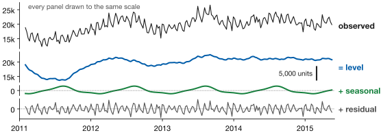
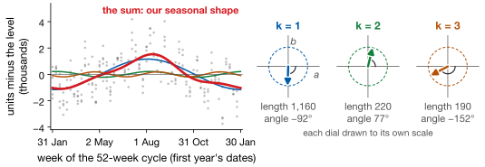
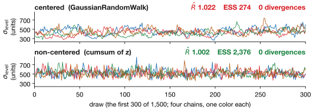
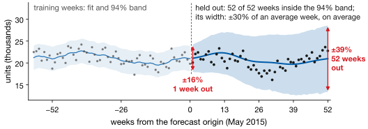
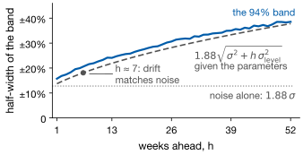

## Lecture Outline

1. Why Bayesian Time Series
2. The Structural Decomposition
3. Fitting It in PyMC
4. Reading the Forecast
5. Key Takeaways

# Why Bayesian Time Series

Not a more accurate forecast — a different deliverable.

---

## What Every Model So Far Gave You

Almost every model so far returned **one number per period**, with at best an interval nobody checked.

*How much stock keeps the chance of a stockout under 5%?* is a question about a distribution. A point forecast cannot answer it, however accurate.

::: {.keybox}
A Bayesian time series model returns a **full predictive distribution for every future period**, and a distribution for each component: trend, seasonality, noise.
:::

**Set expectations now.** It will not beat XGBoost on RMSE, and it barely beats seasonal naive. Judge it by what it hands you.

---

## Three Things That Become Possible

| | |
|---|---|
| **Priors carry knowledge** | "Weekly growth is very unlikely to exceed 20%" is a sentence you can put in the model, rather than hoping the data implies it. |
| **Components get error bars** | Not just a forecast, but "how confident am I that there is a trend at all?" — separately from the seasonality. |
| **Uncertainty compounds honestly** | Forecast 52 weeks out and the interval widens as it should, because the model propagates uncertainty forward instead of assuming it away. |

That third row is the one people underestimate. A prediction interval from ARIMA widens too, but according to a formula derived under assumptions you did not check. Here the widening is a consequence of the model you actually wrote down.

**And the price:** it is slower, it needs priors you have to defend, and — as we will see — it can fail silently in ways a least-squares fit cannot.

# The Structural Decomposition

Write the series as a sum of parts you can name, and put a prior on each.

---

## Structural Time Series: One Equation

The GAM decomposition from Lecture 3, with priors attached:

$$
y_t \;=\; \underbrace{\mu_t}_{\text{level}} \;+\; \underbrace{s_t}_{\text{seasonality}}
\;+\; \underbrace{\varepsilon_t}_{\text{noise}}, \qquad \varepsilon_t \sim \mathcal{N}(0, \sigma^2)
$$

{fig-align="center" height="300px"}

**Each piece is something a business person can name**, and each gets its own posterior: "demand is growing" is about $\mu_t$, "August is our peak" is about $s_t$, "how noisy is this store?" is $\sigma$. That is why it is called *structural*.

---

## The Level: A Random Walk With a Prior On It

The simplest useful trend is a **local level** — the series has a level, and the level itself drifts:

$$\mu_t = \mu_{t-1} + \eta_t, \qquad \eta_t \sim \mathcal{N}(0, \sigma_{\text{level}}^2)$$

Read it as a sentence: this week's level is last week's level, plus a shock. And $\sigma_{\text{level}}$ — which you put a prior on — controls **how fast the level is allowed to move**.

| | |
|---|---|
| Small $\sigma_{\text{level}}$ | A nearly constant level. Rigid, but stable far into the future. |
| Large $\sigma_{\text{level}}$ | A level that chases recent data. Fits well, and forecasts wander. |

**That is a familiar trade in new clothing** — it is the smoothing parameter from Lecture 1's exponential smoothing, and the penalty strength from Lecture 6, now expressed as a prior you can argue about.

---

## Seasonality as Fourier Terms

Fifty-two weekly seasonal parameters would be a lot to estimate. Build the shape from $K$ smooth waves instead, with period $P = 52$:

::: {.smaller}
$$
s_t = \textstyle\sum_{k=1}^{K}\left[a_k \sin\!\left(\tfrac{2\pi k t}{P}\right)
+ b_k \cos\!\left(\tfrac{2\pi k t}{P}\right)\right]
$$
:::

{fig-align="center" height="300px"}

::: {.smaller}
Because $a\sin x + b\cos x = r\sin(x + \varphi)$, each pair $(a_k, b_k)$ is one arrow: its length $r$ is the wave's size, its angle $\varphi$ the wave's timing. We use $K = 3$: six coefficients for fifty-two weeks.
:::

[Same device as Prophet (Lecture 3) and Homework 4; now $a_k$, $b_k$ come back as distributions.]{.neutral}

# Fitting It in PyMC

The model in code, and the check you run before believing any of it.

---

## The Model in PyMC

::: {.examplebox}
::: {.examplebox-title}
Local level $+$ Fourier seasonality
:::
```python
with pm.Model() as model:
    sigma_level = pm.Exponential("sigma_level", 10.0)
    z           = pm.Normal("z", 0, 1, shape=n)     # non-centered
    level = pm.Deterministic("level", pm.math.cumsum(z * sigma_level))
    beta  = pm.Normal("beta", 0, 0.5, shape=2*K)    # Fourier
    sigma = pm.Exponential("sigma", 1.0)

    pm.Normal("obs", mu=level + pm.math.dot(X, beta),
              sigma=sigma, observed=y_scaled)
    idata = pm.sample(1500, tune=2000, chains=4, target_accept=0.95)
```
:::

Line for line this is the equations above — `cumsum` of scaled Normal draws *is* a random walk. **Standardize $y$ first**: these priors assume unit scale, and on raw units of 20,000 they would be absurdly tight.

---

## The First Fit Failed — Here Is What That Looks Like

Written the obvious way, with `pm.GaussianRandomWalk`, the model fails Lecture 10's checks (want $\hat{R} < 1.01$, ESS $> 400$), even at `target_accept=0.95`:

{fig-align="center" height="300px"}

**Nothing crashed**, and the forecast looked reasonable. But the top chains wander: 6,000 draws, worth about 274 independent ones. Only the diagnostics objected.

[The two rows also sit at different heights. The next slide says why.]{.neutral}

---

## The Fix: Reparameterize, Don't Sample More

| **Centered** (the first fit) | **Non-centered** (the fix) |
|---|---|
| `level = pm.GaussianRandomWalk("level", sigma=sigma_level, shape=n)` | `z = pm.Normal("z", 0, 1, shape=n)`<br>`level = pm.math.cumsum(z * sigma_level)` |
| Resize $\sigma_{\text{level}}$ and all 225 levels must move with it: the sampler crawls. | The sampler moves independent standard Normals; the level is built afterwards. |

::: {.warningbox}
**Same data, same 6,000 draws: ESS 274 $\to$ 2,376.** BMCP §4.6.1 covers exactly this, and you will meet it again next week.
:::

[Almost the same model. `GaussianRandomWalk` lets week 1's level start anywhere (its default start, $\mathcal{N}(0, 100)$, raises a warning the lab silences); the `cumsum` starts it near zero. That, not sampling, is why the trace heights differ.]{.neutral}

# Reading the Forecast

The point estimate, the interval, and whether either is any use.

---

## Does It Work? The Point Forecast

CA_1 FOODS, 52 weeks held out.

| Model | Test RMSE |
|---|---:|
| Bayesian structural TS | **1,589** |
| Seasonal naive (same week last year) | 1,660 |

**It beats the benchmark by about 4%.** Real, and small: be suspicious of anyone who calls it a triumph.

And this model was given only the series and a calendar: no lags, no price, no SNAP flags, no store identity. The XGBoost model in Homework 4 had 46 engineered predictors and thirty series to learn from.

**So the point forecast is not the reason to do this.** The next slide is.

---

## The Interval Is the Product

Every forecast comes with a 94% predictive interval. Two different questions about it:

{fig-align="center" height="300px"}

**Calibrated?** 52 of 52 held-out weeks fell inside. Not overconfident, but 94% was promised, so it is conservative.

**Useful?** The width averages 11,700 units on an average week of 19,700: ±30% *on average*, from ±16% one week out to ±39% a year out. Honest, and too wide to order against.

---

## Honest, and Too Wide to Order Against

**Passing the first does not excuse failing the second.** "Between 14,000 and 26,000" is true, and helps nobody.

:::: {.columns}
::: {.column width="44%"}
Given the parameters and today's level, the forecast $h$ weeks out has variance

$$\sigma^2 + h\,\sigma^2_{\text{level}}.$$

The steps add up: once drift outweighs noise (about seven weeks), the band widens like $\sqrt{h}$.
:::
::: {.column width="56%"}
{fig-align="center" height="280px"}
:::
::::

The fix: a model with a stronger opinion, such as a damped level or covariates. **But notice:** we could *ask* whether the uncertainty was honest. No point-forecast model so far let us.

# Key Takeaways

What structural models are for.

---

## Lecture 11 Part 1: Key Takeaways

::: {.keybox}
1. A **structural** model names a series' parts and puts a prior on each.
2. The **local level** is a random walk; $\sigma_{\text{level}}$ sets its speed.
3. **Fourier terms** build seasonality from a few waves, each $(a_k, b_k)$ an arrow.
4. **Check the sampler first:** our first fit looked fine and had not converged.
5. The point forecast beat seasonal naive by **4%**. Not the argument.
6. The interval was **calibrated but too wide to act on**; establishing that is the product.
:::

[Next: hierarchical models, for thirty series at once.]{.neutral}

---

## References

::: {#refs}
:::
