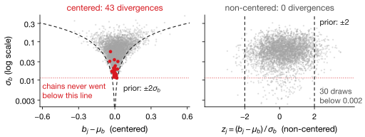
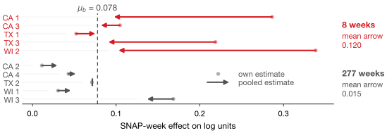
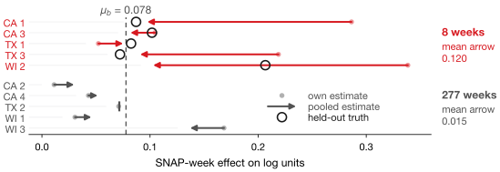

## Lecture Outline

1. Which Series May Be Pooled
2. Partial Pooling
3. Fitting It, and the Trap
4. Reading the Result
5. Key Takeaways

# Which Series May Be Pooled

Before you pool anything, ask what the groups have in common.

---

## The Question

**Does demand rise in weeks when SNAP benefits are disbursed, and by how much — store by store?** Homework 3's memo stocked up store by store, assuming those differences are real. Today we check.

**One question comes before the model.** SNAP is a *food* assistance program. The raw SNAP-week effect on log units, all thirty series by category:

| Category | Mean effect | Spread across stores |
|---|---:|---:|
| **FOODS** (10 series) | $+0.089$ | 0.058 |
| HOBBIES (10 series) | $+0.006$ | 0.010 |
| HOUSEHOLD (10 series) | $+0.011$ | 0.014 |

**These are not thirty versions of the same thing.** FOODS responds; the other two barely move. Pooling all thirty would tell the model they are interchangeable.

---

## Exchangeability: the Assumption Under Every Hierarchy

::: {.definitionbox}
::: {.definitionbox-title}
Exchangeable
:::
Groups are **exchangeable** when, before seeing the data, you have no reason to expect one to differ from another in a particular direction. Swapping their labels would not change what you believe.
:::

The ten FOODS stores qualify: nobody could say in advance which store's SNAP effect is largest. FOODS against HOBBIES does **not**: a food program moves food.

**Today:** the **ten FOODS series**, five thinned to **8 weeks**. That imbalance is the point.

[The lab pools all thirty anyway, and measures what it costs.]{.neutral .smaller}

---

## Complete Pooling and No Pooling

Within that exchangeable set there are two obvious approaches, and each fails in a different direction.

| | What it does | How it fails |
|---|---|---|
| **Complete pooling** | One SNAP effect for all ten series. `b = pm.Normal("b", 0, 1)` | Denies that stores differ at all. A genuinely different store is averaged away. |
| **No pooling** | A separate effect per series, estimated independently. `shape=10` | A series with 8 weeks gets an estimate built from 8 weeks. Mostly noise, reported as a finding. |

**You have used both already without naming them.** Homework 3's random forest pooled all thirty series into one model with store dummies — close to complete pooling. Homework 1 fitted ARIMA to one series at a time — no pooling. The choice has always been made by convenience; partial pooling makes it a modeling decision and lets the data settle it.

# Partial Pooling

Let each series have its own effect — drawn from a shared distribution the data also estimates.

---

## The Hierarchy Is One Extra Line

Give each series its own effect $b_j$, but say where those effects come from:

$$b_j \sim \mathcal{N}(\mu_b,\ \sigma_b), \qquad j = 1, \ldots, 10$$

$\mu_b$ is the typical SNAP effect across FOODS, and $\sigma_b$ is **how much stores genuinely differ**. Crucially, both are estimated from the data rather than assumed.

| | |
|---|---|
| $\sigma_b \rightarrow 0$ | The model concludes stores do not differ, and reproduces complete pooling. |
| $\sigma_b$ large | The model concludes they differ a lot, and approaches no pooling. |
| In between | Each $b_j$ is pulled toward $\mu_b$ — *how far* depending on how much data that series has. |

**That last row is the whole idea.** A series with 277 weeks barely moves; one with 8 weeks moves a long way. Nobody chose those weights — they fall out of the model.

---

## Why This Is the Right Answer, Not a Compromise

Partial pooling sounds like splitting the difference. It is better than that.

With 8 observations, a series' own estimate is mostly noise. Pulling it toward $\mu_b$ is the right response, not a fudge: you would not call a coin biased after three flips.

::: {.keybox}
**Regularization, for the sixth time.** The prior shrinks each group toward $\mu_b$ as Ridge shrinks coefficients toward zero — but the strength, $\sigma_b$, is *estimated*, not tuned by cross-validation.
:::

[Smoothing penalty (L3) $\rightarrow$ pruning (L4) $\rightarrow$ `reg_lambda` (L5) $\rightarrow$ Ridge and LASSO (L6) $\rightarrow$ weight decay (L7) $\rightarrow$ hierarchical priors.]{.neutral .smaller}

# Fitting It, and the Trap

The obvious code does not work, and the reason is geometry rather than statistics.

---

## The Model in PyMC

::: {.examplebox}
::: {.examplebox-title}
Non-centered hierarchical model
:::
```python
with pm.Model() as model:
    mu_b = pm.Normal("mu_b", 0, 0.5)        # typical SNAP effect
    sd_b = pm.HalfNormal("sd_b", 0.25)      # how much stores differ
    z    = pm.Normal("z", 0, 1, shape=J)    # non-centered
    b    = pm.Deterministic("b", mu_b + z * sd_b)

    a = pm.Normal("a", y.mean(), 1, shape=J)  # per-series level
    s = pm.Exponential("s", 1.0)

    pm.Normal("obs", mu=a[idx] + b[idx]*snap, sigma=s, observed=y)
```
:::

`idx` maps each row to its series, so `b[idx]` picks out the right effect for every observation. That indexing pattern is how every hierarchical model in PyMC is written.

**Note what is *not* here.** No decision about how much to pool, no weighting scheme, no threshold for "enough data." Those all come out of estimating $\sigma_b$.

---

## The Trap: Write It the Obvious Way and It Breaks

The natural way to write the hierarchy is `b = pm.Normal("b", mu_b, sd_b, shape=J)` — the *centered* form, which reads exactly like the equation. On our data it produces:

| | Centered | Non-centered | Want |
|---|---:|---:|---|
| Divergences | **43** | **0** | 0 |
| $\hat{R}$ | 1.003 | 1.003 | $< 1.01$ |
| ESS (bulk) | 966 | 1,719 | $> 400$ |

**Only one alarm fires.** $\hat{R}$ and ESS pass; on those alone you would ship it. **43 divergences against a threshold of zero** is the objection to trust.

[Counts move with the seed, even the machine. Ten more seeds: 15–285 divergences centered, 0–11 non-centered; $\hat{R}$ or ESS objected in 2 of the 11 runs, divergences in all 11.]{.neutral .smaller}

---

## Why It Breaks: a Funnel

Every posterior draw for one thin series (CA_1), against $\sigma_b$ on a log axis:

{fig-align="center" height="300px"}

[Given $\sigma_b$, the prior spreads $b_j - \mu_b$ by $\sigma_b$: a funnel, pinched where $\sigma_b$ is small. The divergences sit in the neck (39 of 43 in the bottom tenth of $\sigma_b$), and the chains go no lower. $b_j = \mu_b + \sigma_b z_j$ is a change of coordinates: $z_j$ spreads by 1 at every height, a column the sampler can walk. Exact for the prior; the posterior follows closely.]{.smaller}

[BMCP §4.6.1, *Posterior Geometry Matters*.]{.neutral .smaller}

# Reading the Result

Shrinkage, measured — and checked against data the model never saw.

---

## Shrinkage, Measured

Each series' own (unpooled) estimate, and where the hierarchy moved it:

{fig-align="center" height="300px"}

[**Thin series moved 8.1 times further toward $\mu_b$**]{.key-result}, though nobody said which were thin. Full series keep most of their spread (0.055 → 0.037); thin ones lose it (0.108 → 0.010).

[Each pooled estimate sits approximately at a precision-weighted point between $\mu_b$ and its own: thin series keep about a tenth of theirs, full series about three-quarters. Only approximately, because $\mu_b$ and $\sigma_b$ are integrated over.]{.neutral .smaller}

---

## Checked Against Data the Model Never Saw

The weeks we thinned away still exist. Each ring is the SNAP effect observed in them:

{fig-align="center" height="300px"}

**RMSE against the truth: 0.126 unpooled, 0.048 pooled — 2.6 times smaller.** Pooling won on four series of five; WI_2 shows the cost, pulled past its truth.

[Borrowing strength is not a figure of speech: the thin series were estimated better *because* the other five existed.]{.neutral .smaller}

---

## What the Model Actually Concluded

The estimated hierarchy: $\mu_b = 0.078$ (94% HDI about $[0.02,\ 0.15]$) and $\sigma_b = 0.065$.

So a SNAP week lifts FOODS units by about **8%**, and stores genuinely differ around that by about **7 percentage points**.

::: {.warningbox}
**Not a license for store-by-store stocking.** The thin stores' own estimates ran from $5\%$ to $40\%$. The held-out weeks say that was mostly noise; $\sigma_b = 0.065$ says not *all* of it.
:::

**The defensible plan:** 8% everywhere, modest store variation around it, and no store's own estimate until it has the weeks to support one.

# Key Takeaways

What hierarchy buys, and what it costs.

---

## Lecture 11 Part 2: Key Takeaways

::: {.keybox}
1. **Ask what may be pooled first:** groups must be **exchangeable**. FOODS and HOBBIES are not.

2. **Complete pooling** denies groups differ; **no pooling** reports noise as a finding.

3. **Partial pooling** draws each group's parameter from a shared distribution whose spread is estimated.

4. **Shrinkage is proportionate:** thin series moved **8.1$\times$** further; held-out error was **2.6$\times$** smaller.

5. **Regularization for the sixth time**, with the strength estimated, not tuned.

6. **Write it non-centered.** 43 divergences became 0: same model, a change of coordinates.
:::

[Next: Bayesian linear regression — coefficients as distributions.]{.neutral}

---

## References

::: {#refs}
:::
