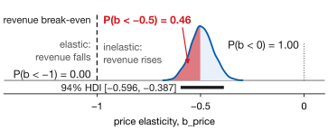
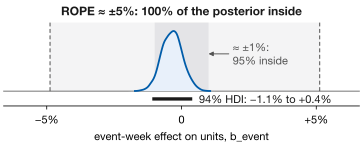
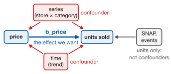
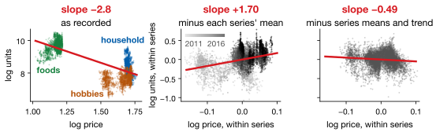

## Lecture Outline

1. Bayesian Linear Regression
2. Reading the Posterior
3. Causal Structure and DAGs
4. Course Synthesis and Next Steps

# Bayesian Linear Regression

The same regression you already know — returning a distribution for every coefficient.

---

## OLS vs. Bayesian Regression: What Changes?

OLS, which you have fitted since Lecture 2, solves for one best coefficient vector:

$$\hat{\boldsymbol{\beta}} = (\mathbf{X}^{\top}\mathbf{X})^{-1}\mathbf{X}^{\top}\mathbf{y}$$

The Bayesian version uses Lecture 10's update rule instead:

$$p(\boldsymbol{\beta} \mid \mathbf{y}) \;\propto\; p(\mathbf{y} \mid \boldsymbol{\beta}) \cdot p(\boldsymbol{\beta})$$

::: {.keybox}
**Every coefficient comes back as a distribution**: not an estimate plus an asymptotic error bar, but a full posterior you can ask questions of.
:::

And Lecture 6 reappears: **regularization is a prior**. The posterior *mode* under a Normal prior is the Ridge estimate; under a Laplace prior, it is the LASSO estimate.

---

## Bayesian Linear Regression in PyMC

::: {.examplebox}
::: {.examplebox-title}
Log units on log price, SNAP, events, series and trend
:::
```python
with pm.Model() as model:
    a       = pm.Normal("a", y.mean(), 1, shape=J)  # one per series
    b_price = pm.Normal("b_price", 0, 1)      # weakly informative
    b_snap  = pm.Normal("b_snap",  0, 1)
    b_event = pm.Normal("b_event", 0, 1)
    b_trend = pm.Normal("b_trend", 0, 1)
    sigma   = pm.Exponential("sigma", 1.0)
    mu = a[idx] + b_price*lpc + b_snap*snap + b_event*event + b_trend*yr
    pm.Normal("obs", mu=mu, sigma=sigma, observed=y)
    idata = pm.sample(1000, tune=1500, chains=4)
```
:::

**Do not standardize log price** — with both in logs `b_price` is an **elasticity**, percent change in demand per percent change in price. `lpc` is log price centered within series, which fixed ESS 184 $\rightarrow$ 3,097.

# Reading the Posterior

Three questions you can ask a distribution that you cannot ask a point estimate.

---

## Reading a Posterior Coefficient

Fitted on the weekly panel, controlling for series and trend:

| Coefficient | Mean | 94% HDI | Reading |
|---|---:|---|---|
| `b_price` | $-0.493$ | $[-0.596,\ -0.387]$ | Inelastic: all of it above $-1$ |
| `b_trend` | $0.110$ | $[0.107,\ 0.113]$ | About 11% growth per year |
| `b_snap` | $0.036$ | $[0.027,\ 0.046]$ | About a 3.7% SNAP-week lift |
| `b_event` | $-0.003$ | $[-0.011,\ 0.004]$ | **Spans zero** |

The **HDI** — highest density interval — is the shortest interval holding 94% of the posterior, and it means what everyone wants: a 94% probability the coefficient is inside.

**The last row is the useful one.** `b_event`'s interval spans zero, so the data do not establish a direction. Two slides on, we ask whether it is also too small to matter.

---

## Asking the Posterior a Direct Question

::: {.examplebox}
::: {.examplebox-title}
Any question about $\beta$ is a count of samples: one line each
:::
```python
b = idata.posterior["b_price"].values.ravel()
(b < 0).mean()       # P(demand falls when price rises)
(b < -1).mean()      # P(elastic: a price rise loses revenue)
(b < -0.5).mean()    # P(a 1% rise costs over 0.5% of volume)
```
:::

{fig-align="center" height="235px"}

Each answer is the share of the area past a line. Demand is **inelastic** in every draw; the half-percent question stays open. **A p-value gives only the direction.**

---

## Too Small to Matter? A ROPE

`b_event`'s HDI spans zero: no direction. A **ROPE** — region of practical equivalence — asks a different question: is the effect too small to act on?

{fig-align="center" height="235px"}

The width is a business choice, not a statistic. We use Homework 7's $|\beta| < 0.05$, about $\pm 5\%$ a week; even at $\pm 1\%$, 95% is inside.

::: {.keybox}
Spans zero and inside the ROPE: **negligible**, stop looking. Spans zero and wide: **still open**, get more data. "Not significant" cannot tell them apart.
:::

# Causal Structure and DAGs

Which coefficients mean what you think they mean.

---

## Directed Acyclic Graphs

A **DAG** is a picture of what you believe causes what, drawn from domain knowledge *before* the model. It decides which variables belong in the regression.

:::: {.columns}
::: {.column width="57%"}
{width="100%"}
:::
::: {.column width="41%"}
[**Confounder**]{style="color: #D71920;"}: causes both predictor and outcome. **Must** be controlled, or it leaks into your coefficient.

**Collider**: caused by both. Controlling for it **creates** a spurious association.
:::
::::

**So "add every control you have" is bad advice**, and no model fit settles it.

[Whether a DAG is right is a business question, not a statistical one.]{.neutral .smaller}

---

## Confounding, Measured

Two confounders move price and units together: the **category** and **time**.

{fig-align="center" height="285px"}

[Food is cheap and sells in volume; prices and volumes both rose, 2011–2016. Removing the series means alone flips the sign. With both removed: $-0.493$, HDI $[-0.596, -0.387]$. The naive $-2.805$, HDI $[-2.856, -2.756]$, is nearly six times too large, at half the width.]{.smaller}

::: {.warningbox}
[**Confidently, precisely wrong**]{.key-result}: a tight interval says the model is sure, not that it answers your question. Only the DAG protects you from an omitted confounder.
:::

---

## Scenario Analysis with Posterior Samples

Push a scenario through the draws to get a **distribution of outcomes**, not one number.

::: {.examplebox}
::: {.examplebox-title}
What if we raise price 5%?
:::
```python
b = idata.posterior["b_price"].values.ravel()
pct_change = 100 * (np.exp(b * np.log(1.05)) - 1)

pct_change.mean(), np.percentile(pct_change, [3, 97])
```
:::

With an elasticity near $-0.493$, a 5% price rise implies roughly a **2.4% fall in units**, 94% of the posterior between $-2.9\%$ and $-1.9\%$.

**The decision follows.** Revenue changes by a factor $1.05^{\,1+b}$, which rises exactly when $b > -1$. Every draw is above $-1$, so $P(\text{revenue rises}) = 1.00$: about $+2.5\%$ on average.

[Valid only to the extent the DAG is — this is a causal claim about intervening on price.]{.neutral .smaller}

# Course Synthesis and Next Steps

From classical time series to Bayesian hierarchical models: a complete forecasting toolkit.

---

## Course Method Map

::: {.smaller}
| Method | Data | Uncertainty | Interpretable | Strengths |
|---|---|---|---|---|
| ETS / ARIMA (L01–02) | Univariate TS | CI | High | Fast, automatic |
| GAM / Prophet (L03) | TS + predictors | Limited | High | Nonlinear + interpretable |
| Decision Tree (L04) | Tabular | No | High | Rule-based explanation |
| Random Forest (L05) | Tabular | OOB error only | Medium | Robust, minimal tuning |
| XGBoost (L05) | Tabular | No | Low | Interactions; 781 on our board |
| Ridge / LASSO (L06) | Tabular | No | High | Best on our board: 744 |
| FFN / 1D CNN (L07–08) | Tabular / TS | No | Low | Flexible nonlinear fits |
| LSTM / Transformer (L09) | Sequences | No | Very low | Long-range dependencies |
| Bayesian (L10–12) | Any | Full posterior | High | Uncertainty, small samples |
:::

::: {.keybox .smaller}
No single method dominates. Choose based on: (1) data type and size, (2) need for uncertainty quantification, (3) need for interpretability, (4) time to deploy. In practice, combine: your scoreboard's winner for the point forecast (here, LASSO) and a Bayesian model for the intervals.
:::

---

## Lecture 12: Key Takeaways

::: {.keybox}
1. **Bayesian regression**: a posterior per $\beta$, whose mode is Ridge (Normal) or LASSO (Laplace).

2. **Ask the posterior directly**: mean, HDI, $P(\beta_j$ past a threshold$)$, mass in a ROPE.

3. **Draw the DAG first**: control confounders (here, series *and* time), never colliders.

4. **Scenarios**: push a counterfactual through the draws to get a distribution of outcomes.

5. **No single method is best**: pair an accurate point forecast with Bayesian intervals.
:::

---

## References

::: {#refs}
:::
