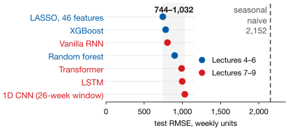
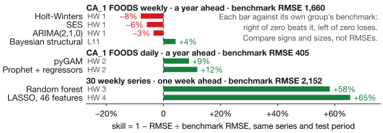
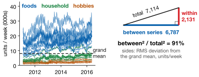
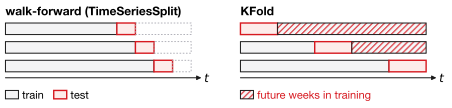
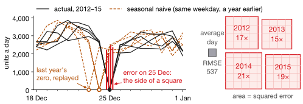

## Lecture Outline

1. What We Built
2. What the Results Taught
3. Choosing a Method
4. Doing It Honestly
5. Where to Go Next

# What We Built

Four parts, twelve lectures, one dataset — and a scoreboard nobody would have predicted in Week 1.

---

## The Arc of the Course

| Part | Lectures | The central idea |
|---|---|---|
| Time series | 1–3 | Specify a structure — level, trend, season — and estimate it. |
| Trees | 4–6 | Stop specifying. Hand an algorithm features and let it find the structure. |
| Deep learning | 7–9 | Let the *architecture* encode what kind of structure to expect. |
| Bayesian | 10–12 | Change the deliverable: return a distribution, not a number. |

Read down that last column and the course is not really four toolkits. It is four answers to a single question: **where does the knowledge in a forecast come from?**

From you, in the model structure. From the data, via a search procedure. From the architecture's assumptions. Or from a prior, stated openly and updated. **That framing is what survives when the libraries change.**

---

## The Scoreboard

Every model in this course, on the M5 weekly panel — same 30 series, same held-out block.

<!-- The table stays: scripts/check-book-claims.py reads the book preface's ranking claims from it. -->
:::: {.columns}
::: {.column width="59%"}
{fig-align="center" width="100%"}
:::
::: {.column width="41%" .smaller}
| Model | Test RMSE | Where |
|---|---:|---|
| LASSO, 46 features | **744** | HW 4 |
| XGBoost | 781 | HW 4 |
| Vanilla RNN | 805 | L9 Part 1 |
| Random forest | 899 | HW 3 |
| Transformer | 990 | L9 Part 2 |
| LSTM | 998 | L9 Part 1 |
| 1D CNN (26-wk) | 1,032 | L8 |
| Seasonal naive | 2,152 | benchmark |
:::
::::

**Not the ordering anyone predicts in Week 1.** A 46-coefficient linear model is on top; the Transformer and the LSTM finished fifth and sixth of eight, behind a plain RNN with a fraction of their parameters, at the training budget each was measured at.

# What the Results Taught

Three lessons, each paid for with a measurement.

---

## Lesson 1: The Benchmark Is a Real Competitor

A year ahead, Homework 1's seasonal naive beat **every smoothing and ARIMA model the assignment asked for**. Holt-Winters estimated **52 seasonal indices from 4.3 annual cycles**; seasonal naive estimates **nothing**.

<!-- Figure: scripts/figures/lecture13_figures.py (skill_bars). Each bar against the seasonal naive on its own series and test period. -->
{fig-align="center" height="360px"}

::: {.keybox}
**Compute the benchmark first, every time.** It costs one line and says whether the rest of the work was worth doing.
:::

---

## Lesson 2: More Sophisticated Did Not Mean Better

Four times this course, the more advanced method failed to win — and each time for a reason we could name.

| | |
|---|---|
| **LSTM lost to a plain RNN** | At three windows, *at a fixed 30-epoch budget*; at 26 weeks they tie by 100 epochs. Gating fixes forgetting, and with 91% of the variance between series there is little to forget. |
| **Transformer lost to an RNN** | 67,329 parameters against roughly **100 effectively independent** 52-week blocks — ours overlap 98%. |
| **CNNs lost to LASSO** | Their 26-week window held no annual lag; LASSO was handed one. |
| **Tuning bought nothing measurable** | Nine fits and a 3-unit change, against a **seed spread of 20–90** at one fixed config. CV improved; test did not. |

**None of these means the losing method is bad** — each solves a problem this data does not have: long dependency chains, large corpora.

---

## Lesson 2, Continued: A Problem This Data Does Not Have

Gates fix forgetting. What does this panel ask a model to remember? Lecture 9's 30 series:

{fig-align="center" height="300px"}

**91%** of the variance is *which series*, not *which week*: little for a gate to keep. Transformers, likewise, earn their parameters on large corpora.

::: {.keybox}
**Match the method to the structure of the problem**, not to the recency of the paper.
:::

---

## Lesson 3: One Idea Appeared Six Times

| Lecture | Name it went by | What it penalized |
|---|---|---|
| 3 | GAM smoothing penalty | Wiggliness of a spline |
| 4 | Cost-complexity pruning | Number of leaves |
| 5 | `reg_lambda`, `gamma` | Leaf weights, leaf count |
| 6 | Ridge, LASSO, Elastic Net | Coefficient size |
| 7 | Weight decay, dropout | Network weights |
| 11 | Hierarchical prior | Distance from the group mean |

Six model families that look nothing alike, one bargain underneath: **fit against complexity, with a single parameter setting the exchange rate.**

Five of those six tune that parameter by cross-validation. The sixth — the hierarchical prior — **estimates it**, which is the cleanest version of the idea in the course.

**This is what to remember when the tools change.** The libraries in this course will be replaced. The trade between fit and complexity will not.

# Choosing a Method

---

## Which Method, When

| If your situation is… | start here |
|---|---|
| One series, clear seasonality, short history | ETS or ARIMA — and check the benchmark |
| Several seasonal cycles at once | GAM or Prophet |
| Many engineered features, tabular | **Regularized regression first**, then XGBoost |
| Many parallel series, shared drivers | Gradient boosting with series identifiers |
| Genuinely long dependencies, lots of data | Recurrent or attention architectures |
| Few observations per group | Hierarchical Bayesian — partial pooling |
| The decision needs a probability | Bayesian, for the predictive distribution |

"Regularized regression first" is not a concession — it won our largest comparison and its coefficients can be read aloud. And the last row is the only one where the *question* changes rather than the accuracy.

# Doing It Honestly

The errors that do not announce themselves.

---

## Errors That Fail Silently I: the Pipeline

Confident, plausible, wrong and silent — and every one a **bug in the code**.

{fig-align="center" height="200px"}

| | |
|---|---|
| `KFold` on a time series | Future weeks train the model; CV looks great, the forecast fails. |
| Scaling outside the fold | Validation statistics leak into training. |
| Rolling features unshifted | The current week leaks the target into its own predictor. |
| Reading MDI importance | Noise ranked **17th of 29** in Homework 3 on distinct values alone. |

**Not a crash but a number that looks fine**, so the discipline is procedural: split by time, scale inside the fold, shift the window, plant a control.

---

## Errors That Fail Silently II: the Code Was Fine

Harder, and more common in professional work. Here **nothing is wrong with the program**: the model fits, the diagnostics pass, and the answer is still wrong.

| | |
|---|---|
| Pooling groups that are not **exchangeable** | Lecture 11 Part 2 pooled ten FOODS series with twenty that ignore SNAP. Textbook shrinkage, clean diagnostics, and it reported $+0.011$ where held-out weeks said $+0.089$. |
| Standardizing a coefficient you then **interpret** | Lecture 12: divide log price by its standard deviation and `b_price` stops being an elasticity. Identical fit, identical diagnostics, and the 5% price scenario moves by **22$\times$**. |
| Omitting a confounder | The naive elasticity was six times too large *with an interval half the width*. Precision is not accuracy. |
| Ignoring $\hat{R}$ and divergences | Our first two Bayesian fits returned reasonable-looking forecasts while failing convergence outright. |

**Only the last row has a diagnostic.** The first three were caught by held-out data, by a DAG drawn before the model, and by asking what one unit of a variable means — none of which any library will run for you.

---

## The Day Every Model in This Course Fails

Every 25 December the stores close and sales are **exactly zero**. CA_1 FOODS, 2012–15:

{fig-align="center" height="255px"}

Four days, **0.25%** of the evaluation window, carry **4.6%** of its squared error. Yet `is_event` fires on **158** days, only **5** of them closures.

::: {.keybox}
Knowable years ahead, and every method failed: the *encoding*, not the model, lumped a locked door in with the Super Bowl.
:::

---

## What a Defensible Forecast Report Contains

| | |
|---|---|
| **A benchmark** | Computed, not cited. Every model measured against it. |
| **A time-aware split** | Walk-forward or a held-out final block, never random. |
| **More than one evaluation** | A single test split can flatter. Homework 4 ranked models the same way twice, which is why that ranking is believable. |
| **The result that went against you** | Including tuning that did not help, and the model you expected to win. |
| **An interpretation** | In the units of the business, not of the loss function. |

**The fourth row is the one that distinguishes professional work.** A report where every result confirms the author's expectation is not a report anyone should act on.

You have practised this all semester: the assignments were built so the obvious answer is frequently the wrong one, and the credit was for noticing.

---

## Where You Do This Yourself

The final project asks for exactly the report on the previous slide, on data of your choosing.

| | |
|---|---|
| **Three methods, from at least two parts of the course** | Classical, trees, deep learning, Bayesian. Three variations on one family does not count — the comparison must be between approaches differing *in kind*. |
| **Plus a benchmark** | Which does not count toward the three, and is not optional. Lesson 1 is why. |
| **Walk-forward validation** | For every comparison. Not a random split, not once. |
| **A recommendation a non-specialist can act on** | In the units of the business, with the uncertainty attached. |
| **A methods reflection** | Which model won, and what about *your* data made it win. This is where the course is actually assessed. |

**The last row is not a formality.** Every scoreboard in this course came with a reason, and a project that reports a ranking without one has done the computation but not the work.

# Where to Go Next

---

## What This Course Did Not Cover

:::: {.columns}
::: {.column width="64%"}
| | |
|---|---|
| **Hierarchical reconciliation** | Store forecasts that add up to regional totals. FPP Ch. 11. |
| **Intermittent demand** | Mostly-zero series: Croston's method and its relatives. |
| **Structural breaks** | The future stops resembling the past, and every method fails together. |
| **Causal inference** | DAGs told us confounders exist; credible causal estimates are a separate course. |
| **Foundation models** | Pretrained forecasters, zero-shot. FPP-Py Ch. 15 is a start. |
:::
::: {.column width="34%"}
{width="78%"}

[Washington, DC, 18 March 2020. Photo: Kurt Kaiser (CC0).]{.neutral style="font-size: 0.55em; display: block; text-align: center;"}
:::
::::

**The third row is the one most likely to matter in your career.** Every model here assumes the future resembles the past. When it stops, the model does not tell you — and the benchmark fails at the same moment.

---

## Closing

::: {.keybox}
1. **Compute the benchmark first.** It says whether the rest was worth doing.
2. **Match the method to the problem**: our most advanced finished fifth.
3. **One idea recurs:** fit against complexity, one parameter setting the rate.
4. **Split by time, always.** Leakage does not crash; it flatters.
5. **Diagnostics check the model, not the question.** Held-out data caught our worst two.
6. **Report what went against you.**
7. **Know what the forecast is for.** Decisions need a distribution.
:::

[The libraries will change. The habits are the transferable part.]{.neutral}

---

## References

::: {#refs}
:::
